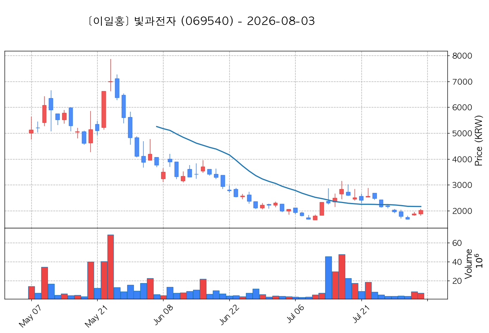
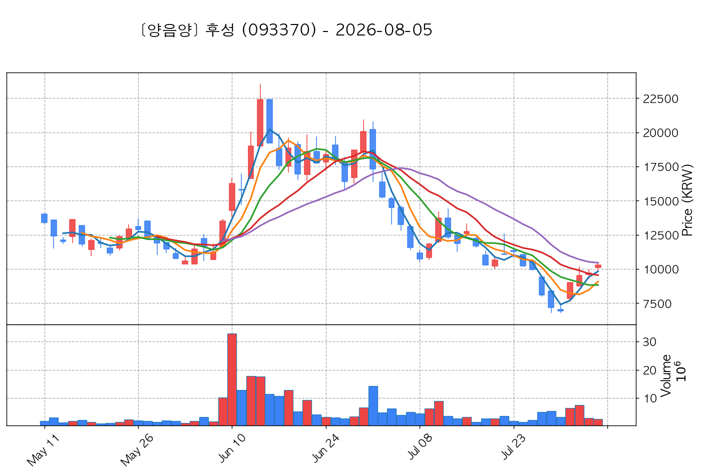

# 📈 [실전플랜 1] 2026-10-12 매매 후보 스크리닝 보고서

> 스크리닝 기준일: 2026-10-12 | [📊 익일 매매 성과 피드백 보고서 보기](./2026-10-12_피드백.html)

---

## 📊 1. 스크리닝 성과 요약

| 전략 | 주요 기법 | 종목수(TOP) |
| :--- | :--- | :---: |
| **전략 1** | 양음양 눌림목 & 사윗감 | 20개 (TOP 3개) |
| **전략 2** | 매집봉 & 이일홍 | 4개 (TOP 1개) |
| **전략 3** | 수급 & 핥 | 4개 (TOP 2개) |
| **합계** | **3대 핵심 전략 통합** | **28개 (TOP 6개)** |

---

## 🔵 3. 전략 1 — 양-음-양 눌림목 (3% × 3슬롯)

### 📋 전략 1 요약표 (상위 10개)

| 종목명 | 기준일종가 | 기준봉 | 지지선 | 비고 및 선정 상태 |
| :--- | ---: | :--- | :---: | :--- |
| **주성엔지니어링** (036930) | 255,000원 | +18.2% 장대양봉 | 3일선 | **★ TOP 1 선택** |
| **HLB** (028300) | 44,650원 | +16.0% 장대양봉 | 3일선 | **★ TOP 2 선택** |
| **빛과전자** (069540) | 4,370원 | +16.8% 장대양봉 | 13일선 | **★ TOP 3 선택** (사윗감) |
| **동국산업** (005160) | 4,545원 | +20.2% 장대양봉 | 3일선 | 후보군 (1위) |
| **티엠씨** (217590) | 16,840원 | 상한가 | 8일선 | 후보군 (2위) |
| **녹십자엠에스** (142280) | 3,725원 | +28.6% 장대양봉 | 5일선 | 후보군 (3위) |
| **라온시큐어** (042510) | 16,055원 | +25.8% 장대양봉 | 3일선 | 후보군 (4위) (사윗감) |
| **삼천당제약** (000250) | 215,000원 | +17.4% 장대양봉 | 8일선 | 후보군 (5위) |
| **제이앤티씨** (204270) | 25,850원 | +20.9% 장대양봉 | 3일선 | 후보군 (6위) |
| **피노** (033790) | 10,270원 | +17.3% 장대양봉 | 3일선 | 후보군 (7위) |

---

### 🔍 전략 1 상세 분석

#### 1) 주성엔지니어링 (036930) — ★ TOP 1 선택

- **기준 종가**: 255,000원 | **거래대금**: 3718억
- **분석 사유**: 과거 2026-10-06 기준봉 후 현재 3일선 지지

#### 2) HLB (028300) — ★ TOP 2 선택

- **기준 종가**: 44,650원 | **거래대금**: 384억
- **분석 사유**: 과거 2026-10-06 기준봉 후 현재 3일선 지지

#### 3) 빛과전자 (069540) — ★ TOP 3 선택 (사윗감)

- **기준 종가**: 4,370원 | **거래대금**: 407억
- **분석 사유**: [쌍바닥참고] 과거 2026-10-06 기준봉 후 현재 13일선 지지

#### 4) 동국산업 (005160) — 후보군 (1위)

- **기준 종가**: 4,545원 | **거래대금**: 192억
- **분석 사유**: 🌪️ [C타입 갭상승털기] 기준봉 익일 갭상승 후 음봉 손바꿈 (기준봉 50% 사수)

#### 5) 티엠씨 (217590) — 후보군 (2위)

- **기준 종가**: 16,840원 | **거래대금**: 152억
- **분석 사유**: 과거 2026-10-02 기준봉 후 현재 8일선 지지

#### 6) 녹십자엠에스 (142280) — 후보군 (3위)

- **기준 종가**: 3,725원 | **거래대금**: 672억
- **분석 사유**: 과거 2026-10-07 기준봉 후 현재 5일선 지지

#### 7) 라온시큐어 (042510) — 후보군 (4위) (사윗감)

- **기준 종가**: 16,055원 | **거래대금**: 916억
- **분석 사유**: 과거 2026-10-06 기준봉 후 현재 3일선 지지

#### 8) 삼천당제약 (000250) — 후보군 (5위)

- **기준 종가**: 215,000원 | **거래대금**: 518억
- **분석 사유**: 과거 2026-10-06 기준봉 후 현재 8일선 지지

#### 9) 제이앤티씨 (204270) — 후보군 (6위)

- **기준 종가**: 25,850원 | **거래대금**: 342억
- **분석 사유**: 과거 2026-10-06 기준봉 후 현재 3일선 지지

#### 10) 피노 (033790) — 후보군 (7위)

- **기준 종가**: 10,270원 | **거래대금**: 300억
- **분석 사유**: 과거 2026-10-08 기준봉 후 현재 3일선 지지

## 🟡 4. 전략 2 — 일일봉 매집봉 (10% × 1슬롯)

### 📋 전략 2 요약표 (상위 4개)

| 종목명 | 기준일종가 | 기준봉 | 지지선 | 비고 및 선정 상태 |
| :--- | ---: | :--- | :---: | :--- |
| **리메드** (302550) | 3,055원 | ★ [1순위 키움정석] 40일 최고가 근접 + 60일선 상승 + 시가대비 +14.4% 속양봉 | 240일선 | **★ TOP 1 선택** |
| **HLB바이오스텝** (278650) | 5,200원 | 과거 2026-09-15 매집봉 ➔ 240일선 근접 지지 (+0.52%) | 240일선 | 후보군 (1위) |
| **LS머트리얼즈** (417200) | 15,540원 | 과거 2026-09-16 매집봉 ➔ 240일선 근접 지지 (-0.44%) | 240일선 | 후보군 (2위) |
| **HB테크놀러지** (078150) | 2,305원 | 과거 2026-09-08 매집봉 ➔ 240일선 근접 지지 (+1.38%) | 240일선 | 후보군 (3위) |

---

### 🔍 전략 2 상세 분석

#### 1) 리메드 (302550) — ★ TOP 1 선택

- **기준 종가**: 3,055원 | **거래대금**: 473억
- **분석 사유**: ★ [1순위 키움정석] 40일 최고가 근접 + 60일선 상승 + 시가대비 +14.4% 속양봉

#### 2) HLB바이오스텝 (278650) — 후보군 (1위)

- **기준 종가**: 5,200원 | **거래대금**: 271억
- **분석 사유**: 과거 2026-09-15 매집봉 ➔ 240일선 근접 지지 (+0.52%)

#### 3) LS머트리얼즈 (417200) — 후보군 (2위)

- **기준 종가**: 15,540원 | **거래대금**: 257억
- **분석 사유**: 과거 2026-09-16 매집봉 ➔ 240일선 근접 지지 (-0.44%)

#### 4) HB테크놀러지 (078150) — 후보군 (3위)

- **기준 종가**: 2,305원 | **거래대금**: 69억
- **분석 사유**: 과거 2026-09-08 매집봉 ➔ 240일선 근접 지지 (+1.38%)

## 🟢 5. 전략 3 — 수급 낙폭과대 바닥형 (10% × 2슬롯)

### 📋 전략 3 요약표 (상위 4개)

| 종목명 | 기준일종가 | 기준봉 | 지지선 | 비고 및 선정 상태 |
| :--- | ---: | :--- | :---: | :--- |
| **한화솔루션** (009830) | 34,600원 | 52주 고점 대비 (61.9%) ➔ 20일 메이저 수급 100억+ 유입 ➔ 120일선 지지 안착 | 수급선 | **★ TOP 1 선택** |
| **서진시스템** (178320) | 41,200원 | 52주 고점 대비 (49.5%) ➔ 20일 메이저 수급 100억+ 유입 ➔ 240일선 지지 안착 | 수급선 | **★ TOP 2 선택** |
| **한온시스템** (018880) | 3,875원 | 52주 고점 대비 (65.2%) ➔ 20일 메이저 수급 100억+ 유입 ➔ 120일선 지지 안착 | 수급선 | 후보군 (1위) |
| **후성** (093370) | 14,390원 | 52주 고점 대비 (61.1%) ➔ 20일 메이저 수급 100억+ 유입 ➔ 없음 지지 안착 | 수급선 | 후보군 (2위) |

---

### 🔍 전략 3 상세 분석

#### 1) 한화솔루션 (009830) — ★ TOP 1 선택

- **기준 종가**: 34,600원 | **거래대금**: 689억
- **분석 사유**: 52주 고점 대비 (61.9%) ➔ 20일 메이저 수급 100억+ 유입 ➔ 120일선 지지 안착

#### 2) 서진시스템 (178320) — ★ TOP 2 선택

- **기준 종가**: 41,200원 | **거래대금**: 569억
- **분석 사유**: 52주 고점 대비 (49.5%) ➔ 20일 메이저 수급 100억+ 유입 ➔ 240일선 지지 안착

#### 3) 한온시스템 (018880) — 후보군 (1위)

- **기준 종가**: 3,875원 | **거래대금**: 274억
- **분석 사유**: 52주 고점 대비 (65.2%) ➔ 20일 메이저 수급 100억+ 유입 ➔ 120일선 지지 안착

#### 4) 후성 (093370) — 후보군 (2위)

- **기준 종가**: 14,390원 | **거래대금**: 258억
- **분석 사유**: 52주 고점 대비 (61.1%) ➔ 20일 메이저 수급 100억+ 유입 ➔ 없음 지지 안착

