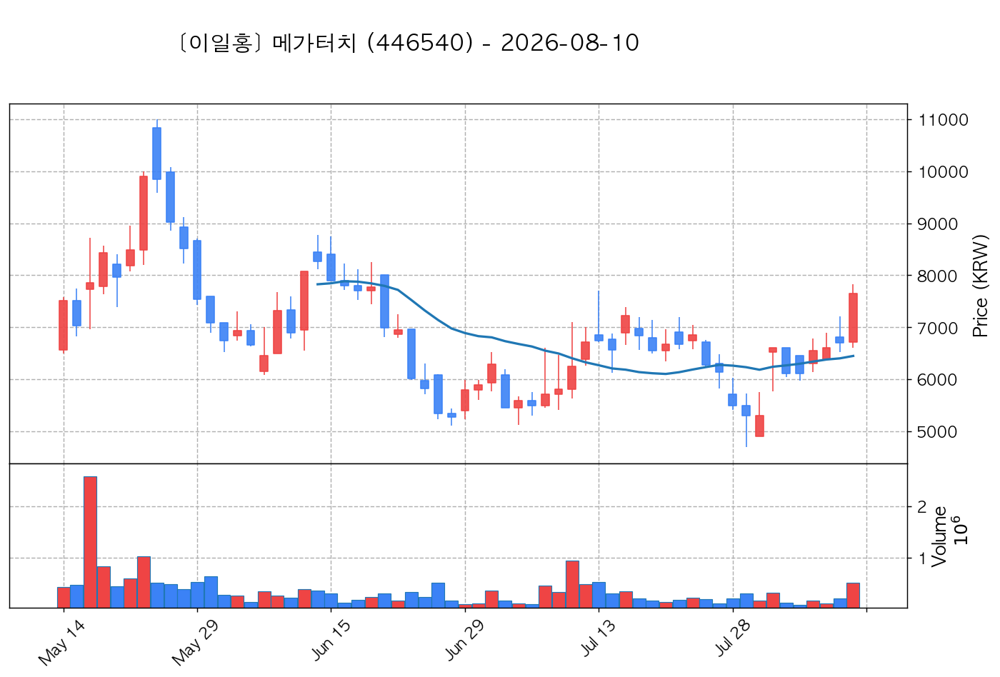

# 📈 [실전플랜 1] 2026-10-13 매매 후보 스크리닝 보고서

> 스크리닝 기준일: 2026-10-13 | [📊 익일 매매 성과 피드백 보고서 보기](./2026-10-13_피드백.html)

---

## 📊 1. 스크리닝 성과 요약

| 전략 | 주요 기법 | 종목수(TOP) |
| :--- | :--- | :---: |
| **전략 1** | 양음양 눌림목 & 사윗감 | 15개 (TOP 3개) |
| **전략 2** | 매집봉 & 이일홍 | 6개 (TOP 1개) |
| **전략 3** | 수급 & 핥 | 2개 (TOP 2개) |
| **합계** | **3대 핵심 전략 통합** | **23개 (TOP 6개)** |

---

## 🔵 3. 전략 1 — 양-음-양 눌림목 (3% × 3슬롯)

### 📋 전략 1 요약표 (상위 10개)

| 종목명 | 기준일종가 | 기준봉 | 지지선 | 비고 및 선정 상태 |
| :--- | ---: | :--- | :---: | :--- |
| **주성엔지니어링** (036930) | 259,000원 | +18.2% 장대양봉 | 3일선 | **★ TOP 1 선택** |
| **HLB** (028300) | 43,650원 | +16.0% 장대양봉 | 3일선 | **★ TOP 2 선택** |
| **금호건설** (002990) | 12,170원 | +24.8% 장대양봉 | 3일선 | **★ TOP 3 선택** |
| **빛과전자** (069540) | 4,140원 | +16.8% 장대양봉 | 20일선 | 후보군 (1위) (사윗감) |
| **삼표시멘트** (038500) | 6,640원 | +15.3% 장대양봉 | 13일선 | 후보군 (2위) |
| **아톤** (158430) | 5,980원 | +25.7% 장대양봉 | 8일선 | 후보군 (3위) |
| **동국산업** (005160) | 4,400원 | +20.2% 장대양봉 | 3일선 | 후보군 (4위) |
| **메가터치** (446540) | 10,760원 | ADK특 13~20선 반등 | 13일선 (0.76%) | 후보군 (5위) |
| **롯데에너지머티리얼즈** (020150) | 51,000원 | +19.5% 장대양봉 | 8일선 | 후보군 (6위) |
| **샌즈랩** (411080) | 7,310원 | 상한가 | 3일선 | 후보군 (7위) (사윗감) |

---

### 🔍 전략 1 상세 분석

#### 1) 주성엔지니어링 (036930) — ★ TOP 1 선택

- **기준 종가**: 259,000원 | **거래대금**: 5231억
- **분석 사유**: 과거 2026-10-06 기준봉 후 현재 3일선 지지

#### 2) HLB (028300) — ★ TOP 2 선택

- **기준 종가**: 43,650원 | **거래대금**: 340억
- **분석 사유**: 과거 2026-10-06 기준봉 후 현재 3일선 지지

#### 3) 금호건설 (002990) — ★ TOP 3 선택

- **기준 종가**: 12,170원 | **거래대금**: 1755억
- **분석 사유**: 🚨[매물대 저항] 🔥[20선 이탈 반등] 과거 2026-10-12 기준봉 후 현재 3일선 지지

#### 4) 빛과전자 (069540) — 후보군 (1위) (사윗감)

- **기준 종가**: 4,140원 | **거래대금**: 303억
- **분석 사유**: 🔥[20선 이탈 반등] 과거 2026-10-06 기준봉 후 현재 20일선 지지

#### 5) 삼표시멘트 (038500) — 후보군 (2위)

- **기준 종가**: 6,640원 | **거래대금**: 636억
- **분석 사유**: 🚨[매물대 저항] 🔥[20선 이탈 반등] 과거 2026-10-07 기준봉 후 현재 13일선 지지

#### 6) 아톤 (158430) — 후보군 (3위)

- **기준 종가**: 5,980원 | **거래대금**: 228억
- **분석 사유**: 🚨[매물대 저항] [쌍바닥참고] 과거 2026-10-06 기준봉 후 현재 8일선 지지

#### 7) 동국산업 (005160) — 후보군 (4위)

- **기준 종가**: 4,400원 | **거래대금**: 199억
- **분석 사유**: 과거 2026-10-08 기준봉 후 현재 3일선 지지

#### 8) 메가터치 (446540) — 후보군 (5위)

- **기준 종가**: 10,760원 | **거래대금**: 48억
- **분석 사유**: ★ [ADK특 TOP1] 20봉내 400억+ Envelope상한 돌파 후 13일선 0.76% 이격 초근접 반등

#### 9) 롯데에너지머티리얼즈 (020150) — 후보군 (6위)

- **기준 종가**: 51,000원 | **거래대금**: 384억
- **분석 사유**: 과거 2026-10-02 기준봉 후 현재 8일선 지지

#### 10) 샌즈랩 (411080) — 후보군 (7위) (사윗감)

- **기준 종가**: 7,310원 | **거래대금**: 259억
- **분석 사유**: 과거 2026-10-06 기준봉 후 현재 3일선 지지

## 🟡 4. 전략 2 — 일일봉 매집봉 (10% × 1슬롯)

### 📋 전략 2 요약표 (상위 6개)

| 종목명 | 기준일종가 | 기준봉 | 지지선 | 비고 및 선정 상태 |
| :--- | ---: | :--- | :---: | :--- |
| **삼화전기** (009470) | 29,100원 | ★ [1순위 키움정석] 40일 최고가 근접 + 60일선 상승 + 시가대비 +20.5% 속양봉 | 240일선 | **★ TOP 1 선택** |
| **세코닉스** (053450) | 3,665원 | ★ [1순위 키움정석] 40일 최고가 근접 + 60일선 상승 + 시가대비 +14.5% 속양봉 | 240일선 | 후보군 (1위) |
| **유신** (054930) | 21,150원 | 과거 2026-08-19 매집봉 ➔ 240일선 근접 지지 (-0.63%) | 240일선 | 후보군 (2위) |
| **나인테크** (267320) | 2,860원 | 과거 2026-09-29 매집봉 ➔ 240일선 근접 지지 (-2.15%) | 240일선 | 후보군 (3위) |
| **한컴위드** (054920) | 4,625원 | 과거 2026-09-11 매집봉 ➔ 240일선 근접 지지 (+1.64%) | 240일선 | 후보군 (4위) |
| **HB테크놀러지** (078150) | 2,235원 | 과거 2026-09-08 매집봉 ➔ 240일선 근접 지지 (-1.74%) | 240일선 | 후보군 (5위) |

---

### 🔍 전략 2 상세 분석

#### 1) 삼화전기 (009470) — ★ TOP 1 선택

- **기준 종가**: 29,100원 | **거래대금**: 133억
- **분석 사유**: ★ [1순위 키움정석] 40일 최고가 근접 + 60일선 상승 + 시가대비 +20.5% 속양봉

#### 2) 세코닉스 (053450) — 후보군 (1위)

- **기준 종가**: 3,665원 | **거래대금**: 93억
- **분석 사유**: ★ [1순위 키움정석] 40일 최고가 근접 + 60일선 상승 + 시가대비 +14.5% 속양봉

#### 3) 유신 (054930) — 후보군 (2위)

- **기준 종가**: 21,150원 | **거래대금**: 359억
- **분석 사유**: 과거 2026-08-19 매집봉 ➔ 240일선 근접 지지 (-0.63%)

#### 4) 나인테크 (267320) — 후보군 (3위)

- **기준 종가**: 2,860원 | **거래대금**: 85억
- **분석 사유**: 과거 2026-09-29 매집봉 ➔ 240일선 근접 지지 (-2.15%)

#### 5) 한컴위드 (054920) — 후보군 (4위)

- **기준 종가**: 4,625원 | **거래대금**: 81억
- **분석 사유**: 과거 2026-09-11 매집봉 ➔ 240일선 근접 지지 (+1.64%)

#### 6) HB테크놀러지 (078150) — 후보군 (5위)

- **기준 종가**: 2,235원 | **거래대금**: 31억
- **분석 사유**: 과거 2026-09-08 매집봉 ➔ 240일선 근접 지지 (-1.74%)

## 🟢 5. 전략 3 — 수급 낙폭과대 바닥형 (10% × 2슬롯)

### 📋 전략 3 요약표 (상위 2개)

| 종목명 | 기준일종가 | 기준봉 | 지지선 | 비고 및 선정 상태 |
| :--- | ---: | :--- | :---: | :--- |
| **한화솔루션** (009830) | 32,550원 | 52주 고점 대비 (58.2%) ➔ 20일 메이저 수급 100억+ 유입 ➔ 120일선 지지 안착 | 수급선 | **★ TOP 1 선택** |
| **한온시스템** (018880) | 3,787원 | 52주 고점 대비 (63.8%) ➔ 20일 메이저 수급 100억+ 유입 ➔ 120일선 지지 안착 | 수급선 | **★ TOP 2 선택** |

---

### 🔍 전략 3 상세 분석

#### 1) 한화솔루션 (009830) — ★ TOP 1 선택

- **기준 종가**: 32,550원 | **거래대금**: 1049억
- **분석 사유**: 52주 고점 대비 (58.2%) ➔ 20일 메이저 수급 100억+ 유입 ➔ 120일선 지지 안착

#### 2) 한온시스템 (018880) — ★ TOP 2 선택

- **기준 종가**: 3,787원 | **거래대금**: 247억
- **분석 사유**: 52주 고점 대비 (63.8%) ➔ 20일 메이저 수급 100억+ 유입 ➔ 120일선 지지 안착

