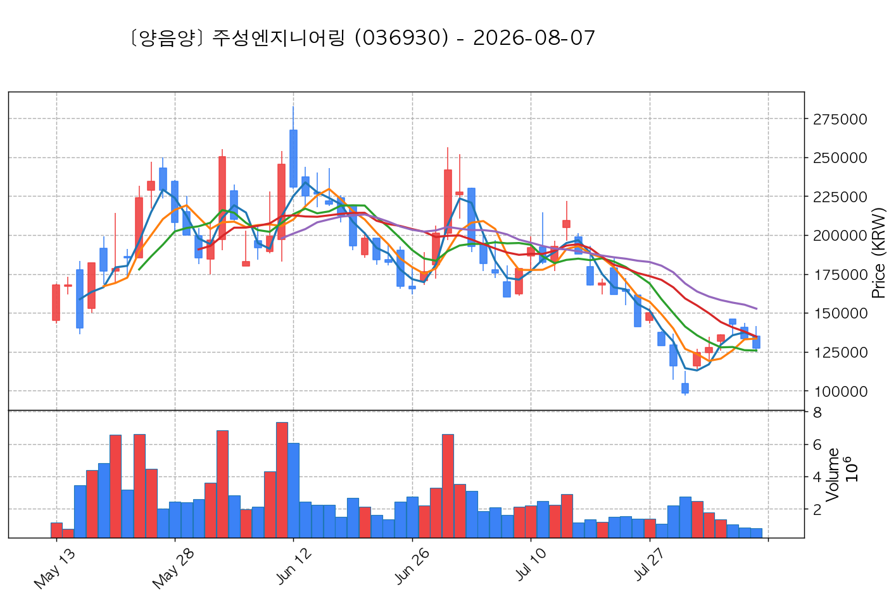
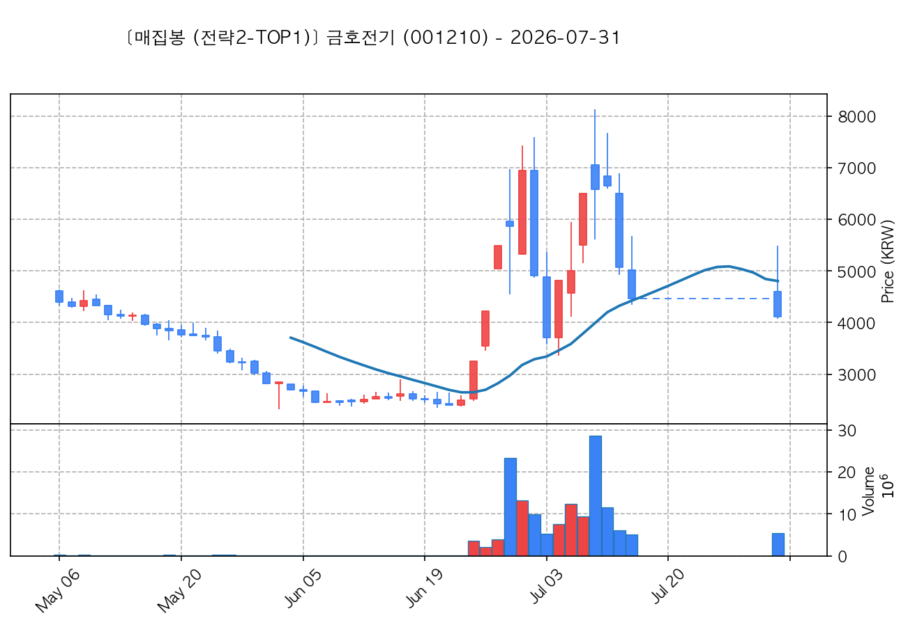

# 📈 [실전플랜 1] 2026-10-14 매매 후보 스크리닝 보고서

> 스크리닝 기준일: 2026-10-14 | [📊 익일 매매 성과 피드백 보고서 보기](./2026-10-14_피드백.html)

---

## 📊 1. 스크리닝 성과 요약

| 전략 | 주요 기법 | 종목수(TOP) |
| :--- | :--- | :---: |
| **전략 1** | 양음양 눌림목 & 사윗감 | 16개 (TOP 3개) |
| **전략 2** | 매집봉 & 이일홍 | 5개 (TOP 1개) |
| **전략 3** | 수급 & 핥 | 0개 (TOP 0개) |
| **합계** | **3대 핵심 전략 통합** | **21개 (TOP 4개)** |

---

## 🔵 3. 전략 1 — 양-음-양 눌림목 (3% × 3슬롯)

### 📋 전략 1 요약표 (상위 10개)

| 종목명 | 기준일종가 | 기준봉 | 지지선 | 비고 및 선정 상태 |
| :--- | ---: | :--- | :---: | :--- |
| **주성엔지니어링** (036930) | 240,500원 | +18.2% 장대양봉 | 13일선 | **★ TOP 1 선택** |
| **HLB** (028300) | 41,800원 | +16.0% 장대양봉 | 13일선 | **★ TOP 2 선택** |
| **삼표시멘트** (038500) | 6,880원 | +15.3% 장대양봉 | 3일선 | **★ TOP 3 선택** |
| **금호전기** (001210) | 9,960원 | 상한가 | 5일선 | 후보군 (1위) (사윗감) |
| **아톤** (158430) | 5,810원 | +25.7% 장대양봉 | 13일선 | 후보군 (2위) |
| **티엠씨** (217590) | 15,050원 | 상한가 | 20일선 | 후보군 (3위) |
| **동국산업** (005160) | 4,440원 | +20.2% 장대양봉 | 3일선 | 후보군 (4위) |
| **녹십자엠에스** (142280) | 3,715원 | +28.6% 장대양봉 | 3일선 | 후보군 (5위) |
| **삼천당제약** (000250) | 204,500원 | +17.4% 장대양봉 | 3일선 | 후보군 (6위) |
| **피노** (033790) | 9,550원 | +17.3% 장대양봉 | 3일선 | 후보군 (7위) |

---

### 🔍 전략 1 상세 분석

#### 1) 주성엔지니어링 (036930) — ★ TOP 1 선택

- **기준 종가**: 240,500원 | **거래대금**: 3733억
- **분석 사유**: 과거 2026-10-06 기준봉 후 현재 13일선 지지

#### 2) HLB (028300) — ★ TOP 2 선택

- **기준 종가**: 41,800원 | **거래대금**: 254억
- **분석 사유**: 과거 2026-10-06 기준봉 후 현재 13일선 지지

#### 3) 삼표시멘트 (038500) — ★ TOP 3 선택

- **기준 종가**: 6,880원 | **거래대금**: 472억
- **분석 사유**: 🚨[매물대 저항] [쌍바닥참고] 과거 2026-10-07 기준봉 후 현재 3일선 지지

#### 4) 금호전기 (001210) — 후보군 (1위) (사윗감)

- **기준 종가**: 9,960원 | **거래대금**: 437억
- **분석 사유**: 🔥[20선 이탈 반등] 과거 2026-10-12 기준봉 후 현재 5일선 지지

#### 5) 아톤 (158430) — 후보군 (2위)

- **기준 종가**: 5,810원 | **거래대금**: 57억
- **분석 사유**: 🚨[매물대 저항] [쌍바닥참고] 과거 2026-10-06 기준봉 후 현재 13일선 지지

#### 6) 티엠씨 (217590) — 후보군 (3위)

- **기준 종가**: 15,050원 | **거래대금**: 102억
- **분석 사유**: [쌍바닥참고] 과거 2026-10-02 기준봉 후 현재 20일선 지지

#### 7) 동국산업 (005160) — 후보군 (4위)

- **기준 종가**: 4,440원 | **거래대금**: 135억
- **분석 사유**: 과거 2026-10-08 기준봉 후 현재 3일선 지지

#### 8) 녹십자엠에스 (142280) — 후보군 (5위)

- **기준 종가**: 3,715원 | **거래대금**: 288억
- **분석 사유**: 과거 2026-10-07 기준봉 후 현재 3일선 지지

#### 9) 삼천당제약 (000250) — 후보군 (6위)

- **기준 종가**: 204,500원 | **거래대금**: 176억
- **분석 사유**: 과거 2026-10-06 기준봉 후 현재 3일선 지지

#### 10) 피노 (033790) — 후보군 (7위)

- **기준 종가**: 9,550원 | **거래대금**: 270억
- **분석 사유**: 과거 2026-10-08 기준봉 후 현재 3일선 지지

## 🟡 4. 전략 2 — 일일봉 매집봉 (10% × 1슬롯)

### 📋 전략 2 요약표 (상위 5개)

| 종목명 | 기준일종가 | 기준봉 | 지지선 | 비고 및 선정 상태 |
| :--- | ---: | :--- | :---: | :--- |
| **대성산업** (128820) | 5,040원 | ★ [1순위 키움정석] 40일 최고가 근접 + 60일선 상승 + 시가대비 +19.0% 속양봉 | 240일선 | **★ TOP 1 선택** |
| **제주항공** (089590) | 5,500원 | ★ [1순위 키움정석] 40일 최고가 근접 + 60일선 상승 + 시가대비 +21.7% 속양봉 | 240일선 | 후보군 (1위) |
| **LS머트리얼즈** (417200) | 16,030원 | 과거 2026-09-16 매집봉 ➔ 240일선 근접 지지 (+2.40%) | 240일선 | 후보군 (2위) |
| **TCC스틸** (002710) | 14,200원 | 과거 2026-09-03 매집봉 ➔ 240일선 근접 지지 (+0.44%) | 240일선 | 후보군 (3위) |
| **넥스틸** (092790) | 13,040원 | 과거 2026-09-10 매집봉 ➔ 240일선 근접 지지 (+2.77%) | 240일선 | 후보군 (4위) |

---

### 🔍 전략 2 상세 분석

#### 1) 대성산업 (128820) — ★ TOP 1 선택

- **기준 종가**: 5,040원 | **거래대금**: 456억
- **분석 사유**: ★ [1순위 키움정석] 40일 최고가 근접 + 60일선 상승 + 시가대비 +19.0% 속양봉

#### 2) 제주항공 (089590) — 후보군 (1위)

- **기준 종가**: 5,500원 | **거래대금**: 223억
- **분석 사유**: ★ [1순위 키움정석] 40일 최고가 근접 + 60일선 상승 + 시가대비 +21.7% 속양봉

#### 3) LS머트리얼즈 (417200) — 후보군 (2위)

- **기준 종가**: 16,030원 | **거래대금**: 1521억
- **분석 사유**: 과거 2026-09-16 매집봉 ➔ 240일선 근접 지지 (+2.40%)

#### 4) TCC스틸 (002710) — 후보군 (3위)

- **기준 종가**: 14,200원 | **거래대금**: 221억
- **분석 사유**: 과거 2026-09-03 매집봉 ➔ 240일선 근접 지지 (+0.44%)

#### 5) 넥스틸 (092790) — 후보군 (4위)

- **기준 종가**: 13,040원 | **거래대금**: 99억
- **분석 사유**: 과거 2026-09-10 매집봉 ➔ 240일선 근접 지지 (+2.77%)

## 🟢 5. 전략 3 — 수급 낙폭과대 바닥형 (10% × 2슬롯)

해당 전략 포착 종목 없음

