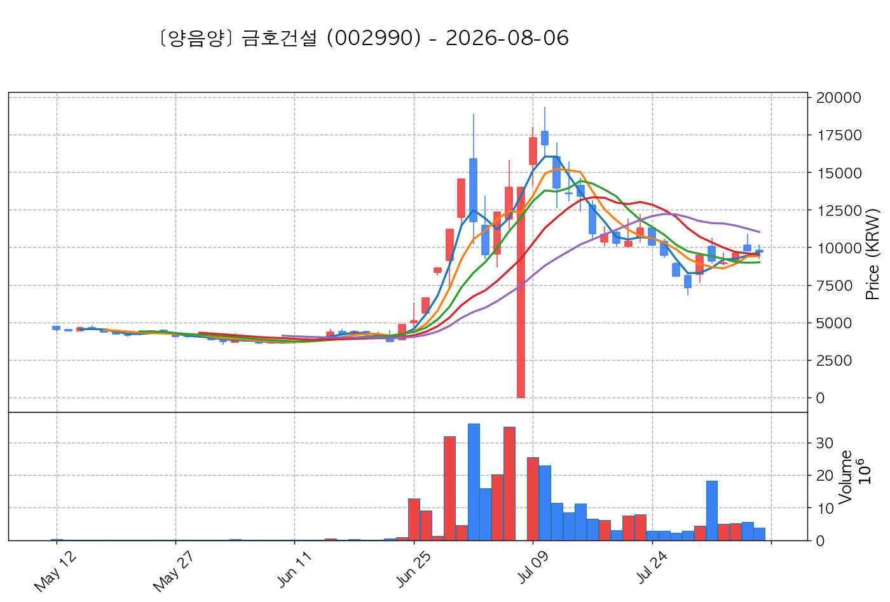

# 📈 [실전플랜 1] 2026-10-19 매매 후보 스크리닝 보고서

> 스크리닝 기준일: 2026-10-19 | [📊 익일 매매 성과 피드백 보고서 보기](./2026-10-19_피드백.html)

---

## 📊 1. 스크리닝 성과 요약

| 전략 | 주요 기법 | 종목수(TOP) |
| :--- | :--- | :---: |
| **전략 1** | 양음양 눌림목 & 사윗감 | 11개 (TOP 3개) |
| **전략 2** | 매집봉 & 이일홍 | 17개 (TOP 1개) |
| **전략 3** | 수급 & 핥 | 0개 (TOP 0개) |
| **합계** | **3대 핵심 전략 통합** | **28개 (TOP 4개)** |

---

## 🔵 3. 전략 1 — 양-음-양 눌림목 (3% × 3슬롯)

### 📋 전략 1 요약표 (상위 10개)

| 종목명 | 기준일종가 | 기준봉 | 지지선 | 비고 및 선정 상태 |
| :--- | ---: | :--- | :---: | :--- |
| **금호건설** (002990) | 10,170원 | +24.8% 장대양봉 | 3일선 | **★ TOP 1 선택** (사윗감) |
| **금호전기** (001210) | 9,160원 | 상한가 | 3일선 | **★ TOP 2 선택** (사윗감) |
| **우리로** (046970) | 8,280원 | +18.6% 장대양봉 | 3일선 | **★ TOP 3 선택** |
| **피노** (033790) | 9,080원 | +17.3% 장대양봉 | 3일선 | 후보군 (1위) |
| **서진시스템** (178320) | 40,550원 | +16.2% 장대양봉 | 13일선 | 후보군 (2위) |
| **동양고속** (084670) | 38,450원 | +22.1% 장대양봉 | 3일선 | 후보군 (3위) (사윗감) |
| **엘앤씨바이오** (290650) | 66,400원 | +23.0% 장대양봉 | 3일선 | 후보군 (4위) |
| **대성산업** (128820) | 4,650원 | +18.4% 장대양봉 | 3일선 | 후보군 (5위) |
| **양지사** (030960) | 5,820원 | 상한가 | 3일선 | 후보군 (6위) |
| **대양금속** (009190) | 984원 | 상한가 | 3일선 | 후보군 (7위) |

---

### 🔍 전략 1 상세 분석

#### 1) 금호건설 (002990) — ★ TOP 1 선택 (사윗감)

- **기준 종가**: 10,170원 | **거래대금**: 71억
- **분석 사유**: 🚨[매물대 저항] 🔥[20선 이탈 반등] 과거 2026-10-12 기준봉 후 현재 3일선 지지

#### 2) 금호전기 (001210) — ★ TOP 2 선택 (사윗감)

- **기준 종가**: 9,160원 | **거래대금**: 161억
- **분석 사유**: 🚨[매물대 저항] 🔥[20선 이탈 반등] 과거 2026-10-12 기준봉 후 현재 3일선 지지

#### 3) 우리로 (046970) — ★ TOP 3 선택

- **기준 종가**: 8,280원 | **거래대금**: 546억
- **분석 사유**: 과거 2026-10-16 기준봉 후 현재 3일선 지지

#### 4) 피노 (033790) — 후보군 (1위)

- **기준 종가**: 9,080원 | **거래대금**: 249억
- **분석 사유**: 과거 2026-10-08 기준봉 후 현재 3일선 지지

#### 5) 서진시스템 (178320) — 후보군 (2위)

- **기준 종가**: 40,550원 | **거래대금**: 497억
- **분석 사유**: 과거 2026-10-16 기준봉 후 현재 13일선 지지

#### 6) 동양고속 (084670) — 후보군 (3위) (사윗감)

- **기준 종가**: 38,450원 | **거래대금**: 116억
- **분석 사유**: 과거 2026-10-14 기준봉 후 현재 3일선 지지

#### 7) 엘앤씨바이오 (290650) — 후보군 (4위)

- **기준 종가**: 66,400원 | **거래대금**: 349억
- **분석 사유**: 🌪️ [C타입 갭상승털기] 기준봉 익일 갭상승 후 음봉 손바꿈 (기준봉 50% 사수)

#### 8) 대성산업 (128820) — 후보군 (5위)

- **기준 종가**: 4,650원 | **거래대금**: 33억
- **분석 사유**: 🚨[매물대 저항] 과거 2026-10-14 기준봉 후 현재 3일선 지지

#### 9) 양지사 (030960) — 후보군 (6위)

- **기준 종가**: 5,820원 | **거래대금**: 315억
- **분석 사유**: 과거 2026-10-15 기준봉 후 현재 3일선 지지

#### 10) 대양금속 (009190) — 후보군 (7위)

- **기준 종가**: 984원 | **거래대금**: 153억
- **분석 사유**: 🌪️ [C타입 갭상승털기] 기준봉 익일 갭상승 후 음봉 손바꿈 (기준봉 50% 사수)

## 🟡 4. 전략 2 — 일일봉 매집봉 (10% × 1슬롯)

### 📋 전략 2 요약표 (상위 10개)

| 종목명 | 기준일종가 | 기준봉 | 지지선 | 비고 및 선정 상태 |
| :--- | ---: | :--- | :---: | :--- |
| **삼성SDI** (006400) | 591,000원 | ★ [1순위 키움정석] 40일 최고가 근접 + 60일선 상승 + 시가대비 +15.2% 속양봉 | 240일선 | **★ TOP 1 선택** |
| **유한양행** (000100) | 87,700원 | ★ [1순위 키움정석] 40일 최고가 근접 + 60일선 상승 + 시가대비 +8.9% 속양봉 | 240일선 | 후보군 (1위) |
| **LG화학** (051910) | 273,500원 | ★ [1순위 키움정석] 40일 최고가 근접 + 60일선 상승 + 시가대비 +12.1% 속양봉 | 240일선 | 후보군 (2위) |
| **레이크머티리얼즈** (281740) | 13,170원 | ★ [1순위 키움정석] 40일 최고가 근접 + 60일선 상승 + 시가대비 +10.4% 속양봉 | 240일선 | 후보군 (3위) |
| **휴니드** (005870) | 4,805원 | ★ [1순위 키움정석] 40일 최고가 근접 + 60일선 상승 + 시가대비 +20.1% 속양봉 | 240일선 | 후보군 (4위) |
| **태광** (023160) | 28,050원 | ★ [1순위 키움정석] 40일 최고가 근접 + 60일선 상승 + 시가대비 +10.0% 속양봉 | 240일선 | 후보군 (5위) |
| **솔루스첨단소재** (336370) | 9,860원 | ★ [1순위 키움정석] 40일 최고가 근접 + 60일선 상승 + 시가대비 +26.7% 속양봉 | 240일선 | 후보군 (6위) |
| **SFA넥셀** (222080) | 8,560원 | ★ [1순위 키움정석] 40일 최고가 근접 + 60일선 상승 + 시가대비 +10.3% 속양봉 | 240일선 | 후보군 (7위) |
| **에코프로에이치엔** (383310) | 25,700원 | ★ [1순위 키움정석] 40일 최고가 근접 + 60일선 상승 + 시가대비 +12.2% 속양봉 | 240일선 | 후보군 (8위) |
| **피엔티** (137400) | 32,150원 | ★ [1순위 키움정석] 40일 최고가 근접 + 60일선 상승 + 시가대비 +9.2% 속양봉 | 240일선 | 후보군 (9위) |

---

### 🔍 전략 2 상세 분석

#### 1) 삼성SDI (006400) — ★ TOP 1 선택

- **기준 종가**: 591,000원 | **거래대금**: 5414억
- **분석 사유**: ★ [1순위 키움정석] 40일 최고가 근접 + 60일선 상승 + 시가대비 +15.2% 속양봉

#### 2) 유한양행 (000100) — 후보군 (1위)

- **기준 종가**: 87,700원 | **거래대금**: 778억
- **분석 사유**: ★ [1순위 키움정석] 40일 최고가 근접 + 60일선 상승 + 시가대비 +8.9% 속양봉

#### 3) LG화학 (051910) — 후보군 (2위)

- **기준 종가**: 273,500원 | **거래대금**: 645억
- **분석 사유**: ★ [1순위 키움정석] 40일 최고가 근접 + 60일선 상승 + 시가대비 +12.1% 속양봉

#### 4) 레이크머티리얼즈 (281740) — 후보군 (3위)

- **기준 종가**: 13,170원 | **거래대금**: 176억
- **분석 사유**: ★ [1순위 키움정석] 40일 최고가 근접 + 60일선 상승 + 시가대비 +10.4% 속양봉

#### 5) 휴니드 (005870) — 후보군 (4위)

- **기준 종가**: 4,805원 | **거래대금**: 132억
- **분석 사유**: ★ [1순위 키움정석] 40일 최고가 근접 + 60일선 상승 + 시가대비 +20.1% 속양봉

#### 6) 태광 (023160) — 후보군 (5위)

- **기준 종가**: 28,050원 | **거래대금**: 69억
- **분석 사유**: ★ [1순위 키움정석] 40일 최고가 근접 + 60일선 상승 + 시가대비 +10.0% 속양봉

#### 7) 솔루스첨단소재 (336370) — 후보군 (6위)

- **기준 종가**: 9,860원 | **거래대금**: 67억
- **분석 사유**: ★ [1순위 키움정석] 40일 최고가 근접 + 60일선 상승 + 시가대비 +26.7% 속양봉

#### 8) SFA넥셀 (222080) — 후보군 (7위)

- **기준 종가**: 8,560원 | **거래대금**: 59억
- **분석 사유**: ★ [1순위 키움정석] 40일 최고가 근접 + 60일선 상승 + 시가대비 +10.3% 속양봉

#### 9) 에코프로에이치엔 (383310) — 후보군 (8위)

- **기준 종가**: 25,700원 | **거래대금**: 57억
- **분석 사유**: ★ [1순위 키움정석] 40일 최고가 근접 + 60일선 상승 + 시가대비 +12.2% 속양봉

#### 10) 피엔티 (137400) — 후보군 (9위)

- **기준 종가**: 32,150원 | **거래대금**: 40억
- **분석 사유**: ★ [1순위 키움정석] 40일 최고가 근접 + 60일선 상승 + 시가대비 +9.2% 속양봉

## 🟢 5. 전략 3 — 수급 낙폭과대 바닥형 (10% × 2슬롯)

해당 전략 포착 종목 없음

