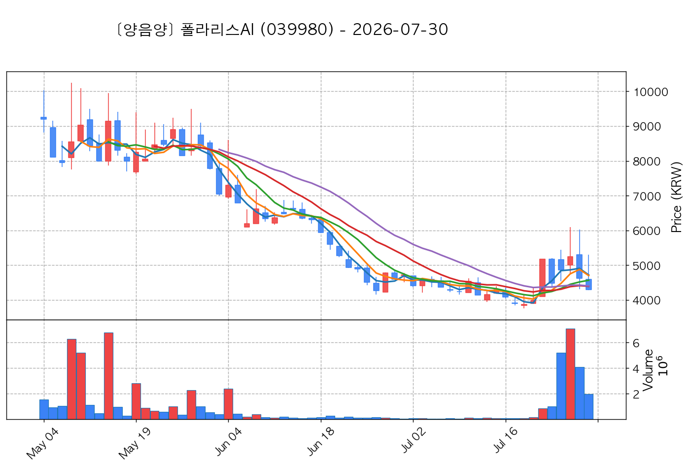

# 📈 [실전플랜 1] 2026-10-22 매매 후보 스크리닝 보고서

> 스크리닝 기준일: 2026-10-22 | [📊 익일 매매 성과 피드백 보고서 보기](./2026-10-22_피드백.html)

---

## 📊 1. 스크리닝 성과 요약

| 전략 | 주요 기법 | 종목수(TOP) |
| :--- | :--- | :---: |
| **전략 1** | 양음양 눌림목 & 사윗감 | 21개 (TOP 3개) |
| **전략 2** | 매집봉 & 이일홍 | 10개 (TOP 1개) |
| **전략 3** | 수급 & 핥 | 0개 (TOP 0개) |
| **합계** | **3대 핵심 전략 통합** | **31개 (TOP 4개)** |

---

## 🔵 3. 전략 1 — 양-음-양 눌림목 (3% × 3슬롯)

### 📋 전략 1 요약표 (상위 10개)

| 종목명 | 기준일종가 | 기준봉 | 지지선 | 비고 및 선정 상태 |
| :--- | ---: | :--- | :---: | :--- |
| **HT로보틱스** (396300) | 9,990원 | +23.5% 장대양봉 | 5일선 | **★ TOP 1 선택** |
| **대한광통신** (010170) | 13,310원 | +16.9% 장대양봉 | 3일선 | **★ TOP 2 선택** |
| **삼기에너지솔루션즈** (419050) | 2,355원 | +23.3% 장대양봉 | 8일선 | **★ TOP 3 선택** |
| **우리로** (046970) | 8,260원 | +18.6% 장대양봉 | 3일선 | 후보군 (1위) |
| **한선엔지니어링** (452280) | 15,780원 | +28.1% 장대양봉 | 3일선 | 후보군 (2위) |
| **서산** (079650) | 7,000원 | +22.2% 장대양봉 | 13일선 | 후보군 (3위) (사윗감) |
| **명신산업** (009900) | 9,920원 | +19.6% 장대양봉 | 3일선 | 후보군 (4위) |
| **양지사** (030960) | 6,450원 | +15.4% 장대양봉 | 3일선 | 후보군 (5위) |
| **동양고속** (084670) | 31,850원 | +22.1% 장대양봉 | 3일선 | 후보군 (6위) (사윗감) |
| **앤로보틱스** (138360) | 1,630원 | +21.1% 장대양봉 | 3일선 | 후보군 (7위) |

---

### 🔍 전략 1 상세 분석

#### 1) HT로보틱스 (396300) — ★ TOP 1 선택

- **기준 종가**: 9,990원 | **거래대금**: 621억
- **분석 사유**: 과거 2026-10-16 기준봉 후 현재 5일선 지지

#### 2) 대한광통신 (010170) — ★ TOP 2 선택

- **기준 종가**: 13,310원 | **거래대금**: 1107억
- **분석 사유**: 🔥[20선 이탈 반등] 과거 2026-10-21 기준봉 후 현재 3일선 지지

#### 3) 삼기에너지솔루션즈 (419050) — ★ TOP 3 선택

- **기준 종가**: 2,355원 | **거래대금**: 83억
- **분석 사유**: 🚨[매물대 저항] 과거 2026-10-19 기준봉 후 현재 8일선 지지

#### 4) 우리로 (046970) — 후보군 (1위)

- **기준 종가**: 8,260원 | **거래대금**: 270억
- **분석 사유**: [쌍바닥참고] 과거 2026-10-16 기준봉 후 현재 3일선 지지

#### 5) 한선엔지니어링 (452280) — 후보군 (2위)

- **기준 종가**: 15,780원 | **거래대금**: 428억
- **분석 사유**: 과거 2026-10-14 기준봉 후 현재 3일선 지지

#### 6) 서산 (079650) — 후보군 (3위) (사윗감)

- **기준 종가**: 7,000원 | **거래대금**: 52억
- **분석 사유**: 🚨[매물대 저항] 과거 2026-10-16 기준봉 후 현재 13일선 지지

#### 7) 명신산업 (009900) — 후보군 (4위)

- **기준 종가**: 9,920원 | **거래대금**: 180억
- **분석 사유**: 🌪️ [C타입 갭상승털기] 기준봉 익일 갭상승 후 음봉 손바꿈 (기준봉 50% 사수)

#### 8) 양지사 (030960) — 후보군 (5위)

- **기준 종가**: 6,450원 | **거래대금**: 215억
- **분석 사유**: 과거 2026-10-20 기준봉 후 현재 3일선 지지

#### 9) 동양고속 (084670) — 후보군 (6위) (사윗감)

- **기준 종가**: 31,850원 | **거래대금**: 96억
- **분석 사유**: 🚨[매물대 저항] 과거 2026-10-14 기준봉 후 현재 3일선 지지

#### 10) 앤로보틱스 (138360) — 후보군 (7위)

- **기준 종가**: 1,630원 | **거래대금**: 280억
- **분석 사유**: 🌪️ [C타입 갭상승털기] 기준봉 익일 갭상승 후 음봉 손바꿈 (기준봉 50% 사수)

## 🟡 4. 전략 2 — 일일봉 매집봉 (10% × 1슬롯)

### 📋 전략 2 요약표 (상위 10개)

| 종목명 | 기준일종가 | 기준봉 | 지지선 | 비고 및 선정 상태 |
| :--- | ---: | :--- | :---: | :--- |
| **대모** (317850) | 6,390원 | ★ [1순위 키움정석] 40일 최고가 근접 + 60일선 상승 + 시가대비 +5.1% 속양봉 | 240일선 | **★ TOP 1 선택** |
| **폴라리스AI** (039980) | 5,660원 | ★ [1순위 키움정석] 40일 최고가 근접 + 60일선 상승 + 시가대비 +14.8% 속양봉 | 240일선 | 후보군 (1위) |
| **휴니드** (005870) | 4,875원 | ★ [1순위 키움정석] 40일 최고가 근접 + 60일선 상승 + 시가대비 +5.7% 속양봉 | 240일선 | 후보군 (2위) |
| **빅텍** (065450) | 3,710원 | 과거 2026-09-29 매집봉 ➔ 240일선 근접 지지 (-2.78%) | 240일선 | 후보군 (3위) |
| **토마토시스템** (393210) | 3,955원 | 과거 2026-09-23 매집봉 ➔ 240일선 근접 지지 (+0.05%) | 240일선 | 후보군 (4위) |
| **샌즈랩** (411080) | 6,060원 | 과거 2026-08-28 매집봉 ➔ 240일선 근접 지지 (-2.71%) | 240일선 | 후보군 (5위) |
| **녹십자엠에스** (142280) | 3,640원 | 과거 2026-08-24 매집봉 ➔ 240일선 근접 지지 (-0.19%) | 240일선 | 후보군 (6위) |
| **아이씨티케이** (456010) | 17,650원 | 과거 2026-09-11 매집봉 ➔ 240일선 근접 지지 (-2.07%) | 240일선 | 후보군 (7위) |
| **알루코** (001780) | 2,020원 | 과거 2026-10-08 매집봉 ➔ 240일선 근접 지지 (-1.60%) | 240일선 | 후보군 (8위) |
| **나노엔텍** (039860) | 4,565원 | 과거 2026-09-01 매집봉 ➔ 240일선 근접 지지 (-0.87%) | 240일선 | 후보군 (9위) |

---

### 🔍 전략 2 상세 분석

#### 1) 대모 (317850) — ★ TOP 1 선택

- **기준 종가**: 6,390원 | **거래대금**: 333억
- **분석 사유**: ★ [1순위 키움정석] 40일 최고가 근접 + 60일선 상승 + 시가대비 +5.1% 속양봉

#### 2) 폴라리스AI (039980) — 후보군 (1위)

- **기준 종가**: 5,660원 | **거래대금**: 236억
- **분석 사유**: ★ [1순위 키움정석] 40일 최고가 근접 + 60일선 상승 + 시가대비 +14.8% 속양봉

#### 3) 휴니드 (005870) — 후보군 (2위)

- **기준 종가**: 4,875원 | **거래대금**: 122억
- **분석 사유**: ★ [1순위 키움정석] 40일 최고가 근접 + 60일선 상승 + 시가대비 +5.7% 속양봉

#### 4) 빅텍 (065450) — 후보군 (3위)

- **기준 종가**: 3,710원 | **거래대금**: 901억
- **분석 사유**: 과거 2026-09-29 매집봉 ➔ 240일선 근접 지지 (-2.78%)

#### 5) 토마토시스템 (393210) — 후보군 (4위)

- **기준 종가**: 3,955원 | **거래대금**: 352억
- **분석 사유**: 과거 2026-09-23 매집봉 ➔ 240일선 근접 지지 (+0.05%)

#### 6) 샌즈랩 (411080) — 후보군 (5위)

- **기준 종가**: 6,060원 | **거래대금**: 85억
- **분석 사유**: 과거 2026-08-28 매집봉 ➔ 240일선 근접 지지 (-2.71%)

#### 7) 녹십자엠에스 (142280) — 후보군 (6위)

- **기준 종가**: 3,640원 | **거래대금**: 74억
- **분석 사유**: 과거 2026-08-24 매집봉 ➔ 240일선 근접 지지 (-0.19%)

#### 8) 아이씨티케이 (456010) — 후보군 (7위)

- **기준 종가**: 17,650원 | **거래대금**: 73억
- **분석 사유**: 과거 2026-09-11 매집봉 ➔ 240일선 근접 지지 (-2.07%)

#### 9) 알루코 (001780) — 후보군 (8위)

- **기준 종가**: 2,020원 | **거래대금**: 60억
- **분석 사유**: 과거 2026-10-08 매집봉 ➔ 240일선 근접 지지 (-1.60%)

#### 10) 나노엔텍 (039860) — 후보군 (9위)

- **기준 종가**: 4,565원 | **거래대금**: 35억
- **분석 사유**: 과거 2026-09-01 매집봉 ➔ 240일선 근접 지지 (-0.87%)

## 🟢 5. 전략 3 — 수급 낙폭과대 바닥형 (10% × 2슬롯)

해당 전략 포착 종목 없음

