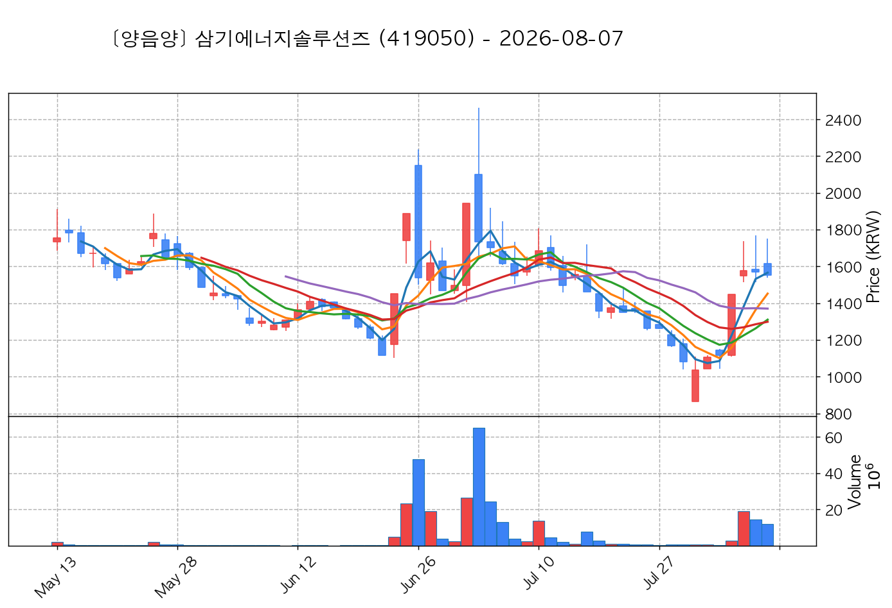
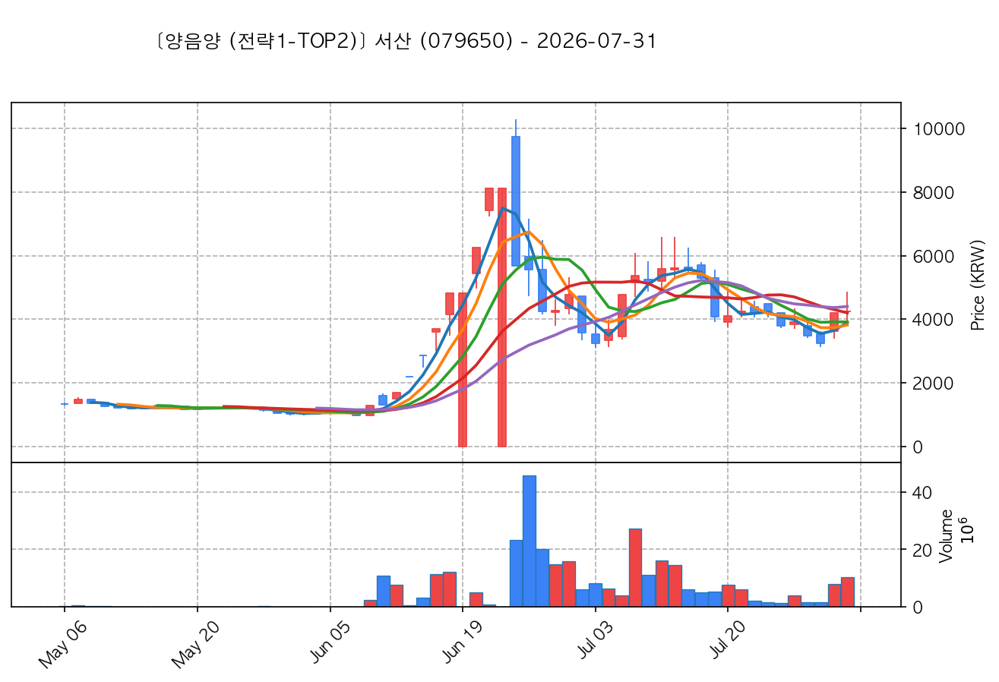

# 📈 [실전플랜 1] 2026-10-23 매매 후보 스크리닝 보고서

> 스크리닝 기준일: 2026-10-23 | [📊 익일 매매 성과 피드백 보고서 보기](./2026-10-23_피드백.html)

---

## 📊 1. 스크리닝 성과 요약

| 전략 | 주요 기법 | 종목수(TOP) |
| :--- | :--- | :---: |
| **전략 1** | 양음양 눌림목 & 사윗감 | 15개 (TOP 3개) |
| **전략 2** | 매집봉 & 이일홍 | 4개 (TOP 1개) |
| **전략 3** | 수급 & 핥 | 0개 (TOP 0개) |
| **합계** | **3대 핵심 전략 통합** | **19개 (TOP 4개)** |

---

## 🔵 3. 전략 1 — 양-음-양 눌림목 (3% × 3슬롯)

### 📋 전략 1 요약표 (상위 10개)

| 종목명 | 기준일종가 | 기준봉 | 지지선 | 비고 및 선정 상태 |
| :--- | ---: | :--- | :---: | :--- |
| **HT로보틱스** (396300) | 9,250원 | +23.5% 장대양봉 | 8일선 | **★ TOP 1 선택** |
| **대한광통신** (010170) | 13,800원 | +16.9% 장대양봉 | 3일선 | **★ TOP 2 선택** |
| **삼기에너지솔루션즈** (419050) | 2,255원 | +23.3% 장대양봉 | 13일선 | **★ TOP 3 선택** |
| **서산** (079650) | 7,320원 | +22.2% 장대양봉 | 3일선 | 후보군 (1위) (사윗감) |
| **명신산업** (009900) | 9,160원 | +19.6% 장대양봉 | 5일선 | 후보군 (2위) |
| **양지사** (030960) | 5,950원 | +15.4% 장대양봉 | 8일선 | 후보군 (3위) |
| **서진시스템** (178320) | 33,250원 | +16.2% 장대양봉 | 3일선 | 후보군 (4위) |
| **엘앤씨바이오** (290650) | 60,600원 | +23.0% 장대양봉 | 3일선 | 후보군 (5위) |
| **롯데에너지머티리얼즈** (020150) | 49,950원 | +17.8% 장대양봉 | 20일선 | 후보군 (6위) |
| **리브스메드** (491000) | 38,150원 | 상한가 | 13일선 | 후보군 (7위) |

---

### 🔍 전략 1 상세 분석

#### 1) HT로보틱스 (396300) — ★ TOP 1 선택

- **기준 종가**: 9,250원 | **거래대금**: 495억
- **분석 사유**: 과거 2026-10-16 기준봉 후 현재 8일선 지지

#### 2) 대한광통신 (010170) — ★ TOP 2 선택

- **기준 종가**: 13,800원 | **거래대금**: 754억
- **분석 사유**: 🔥[20선 이탈 반등] 과거 2026-10-21 기준봉 후 현재 3일선 지지

#### 3) 삼기에너지솔루션즈 (419050) — ★ TOP 3 선택

- **기준 종가**: 2,255원 | **거래대금**: 59억
- **분석 사유**: 🚨[매물대 저항] 과거 2026-10-19 기준봉 후 현재 13일선 지지

#### 4) 서산 (079650) — 후보군 (1위) (사윗감)

- **기준 종가**: 7,320원 | **거래대금**: 108억
- **분석 사유**: 🚨[매물대 저항] 과거 2026-10-16 기준봉 후 현재 3일선 지지

#### 5) 명신산업 (009900) — 후보군 (2위)

- **기준 종가**: 9,160원 | **거래대금**: 76억
- **분석 사유**: 🚨[매물대 저항] 과거 2026-10-21 기준봉 후 현재 5일선 지지

#### 6) 양지사 (030960) — 후보군 (3위)

- **기준 종가**: 5,950원 | **거래대금**: 177억
- **분석 사유**: 🚨[매물대 저항] 과거 2026-10-20 기준봉 후 현재 8일선 지지

#### 7) 서진시스템 (178320) — 후보군 (4위)

- **기준 종가**: 33,250원 | **거래대금**: 279억
- **분석 사유**: 🚨[매물대 저항] 🔥[20선 이탈 반등] 과거 2026-10-16 기준봉 후 현재 3일선 지지

#### 8) 엘앤씨바이오 (290650) — 후보군 (5위)

- **기준 종가**: 60,600원 | **거래대금**: 151억
- **분석 사유**: 과거 2026-10-16 기준봉 후 현재 3일선 지지

#### 9) 롯데에너지머티리얼즈 (020150) — 후보군 (6위)

- **기준 종가**: 49,950원 | **거래대금**: 203억
- **분석 사유**: 🔥[20선 이탈 반등] 과거 2026-10-19 기준봉 후 현재 20일선 지지

#### 10) 리브스메드 (491000) — 후보군 (7위)

- **기준 종가**: 38,150원 | **거래대금**: 50억
- **분석 사유**: 과거 2026-10-16 기준봉 후 현재 13일선 지지

## 🟡 4. 전략 2 — 일일봉 매집봉 (10% × 1슬롯)

### 📋 전략 2 요약표 (상위 4개)

| 종목명 | 기준일종가 | 기준봉 | 지지선 | 비고 및 선정 상태 |
| :--- | ---: | :--- | :---: | :--- |
| **빅텍** (065450) | 3,770원 | 과거 2026-09-29 매집봉 ➔ 240일선 근접 지지 (-1.21%) | 240일선 | **★ TOP 1 선택** |
| **샌즈랩** (411080) | 6,170원 | 과거 2026-08-28 매집봉 ➔ 240일선 근접 지지 (-0.82%) | 240일선 | 후보군 (1위) |
| **나노엔텍** (039860) | 4,625원 | 과거 2026-09-01 매집봉 ➔ 240일선 근접 지지 (+0.31%) | 240일선 | 후보군 (2위) |
| **천일고속** (000650) | 209,000원 | 과거 2026-10-12 매집봉 ➔ 240일선 근접 지지 (-0.34%) | 240일선 | 후보군 (3위) |

---

### 🔍 전략 2 상세 분석

#### 1) 빅텍 (065450) — ★ TOP 1 선택

- **기준 종가**: 3,770원 | **거래대금**: 1483억
- **분석 사유**: 과거 2026-09-29 매집봉 ➔ 240일선 근접 지지 (-1.21%)

#### 2) 샌즈랩 (411080) — 후보군 (1위)

- **기준 종가**: 6,170원 | **거래대금**: 300억
- **분석 사유**: 과거 2026-08-28 매집봉 ➔ 240일선 근접 지지 (-0.82%)

#### 3) 나노엔텍 (039860) — 후보군 (2위)

- **기준 종가**: 4,625원 | **거래대금**: 168억
- **분석 사유**: 과거 2026-09-01 매집봉 ➔ 240일선 근접 지지 (+0.31%)

#### 4) 천일고속 (000650) — 후보군 (3위)

- **기준 종가**: 209,000원 | **거래대금**: 164억
- **분석 사유**: 과거 2026-10-12 매집봉 ➔ 240일선 근접 지지 (-0.34%)

## 🟢 5. 전략 3 — 수급 낙폭과대 바닥형 (10% × 2슬롯)

해당 전략 포착 종목 없음

