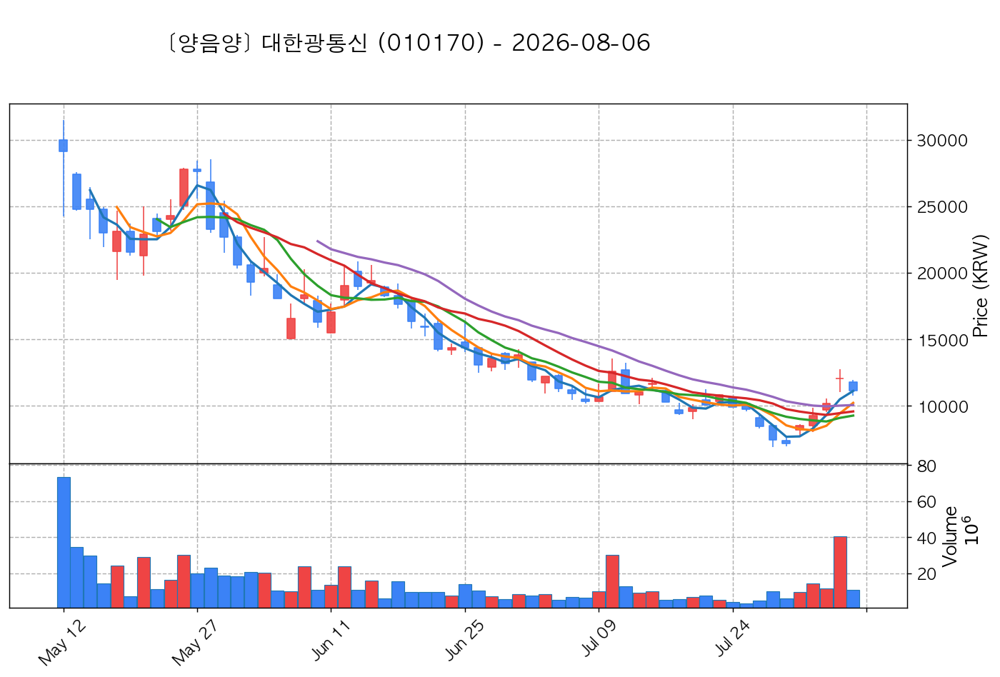
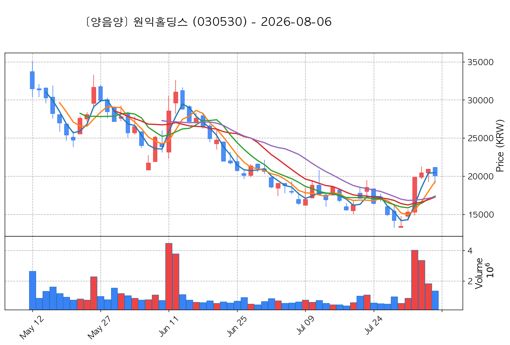

# 📈 [실전플랜 1] 2026-10-28 매매 후보 스크리닝 보고서

> 스크리닝 기준일: 2026-10-28 | [📊 익일 매매 성과 피드백 보고서 보기](./2026-10-28_피드백.html)

---

## 📊 1. 스크리닝 성과 요약

| 전략 | 주요 기법 | 종목수(TOP) |
| :--- | :--- | :---: |
| **전략 1** | 양음양 눌림목 & 사윗감 | 11개 (TOP 3개) |
| **전략 2** | 매집봉 & 이일홍 | 7개 (TOP 1개) |
| **전략 3** | 수급 & 핥 | 0개 (TOP 0개) |
| **합계** | **3대 핵심 전략 통합** | **18개 (TOP 4개)** |

---

## 🔵 3. 전략 1 — 양-음-양 눌림목 (3% × 3슬롯)

### 📋 전략 1 요약표 (상위 10개)

| 종목명 | 기준일종가 | 기준봉 | 지지선 | 비고 및 선정 상태 |
| :--- | ---: | :--- | :---: | :--- |
| **대한광통신** (010170) | 14,960원 | +16.9% 장대양봉 | 20일선 | **★ TOP 1 선택** |
| **빅텍** (065450) | 3,155원 | +17.5% 장대양봉 | 8일선 | **★ TOP 2 선택** (사윗감) |
| **앤로보틱스** (138360) | 2,085원 | +20.1% 장대양봉 | 3일선 | **★ TOP 3 선택** |
| **명신산업** (009900) | 9,230원 | +19.6% 장대양봉 | 5일선 | 후보군 (1위) |
| **지투지바이오** (456160) | 37,250원 | +18.8% 장대양봉 | 13일선 | 후보군 (2위) |
| **컨텍** (451760) | 10,610원 | 상한가 | 3일선 | 후보군 (3위) (사윗감) |
| **양지사** (030960) | 5,670원 | +15.4% 장대양봉 | 3일선 | 후보군 (4위) |
| **루닛** (328130) | 14,470원 | 상한가 | 3일선 | 후보군 (5위) (사윗감) |
| **혜인** (003010) | 8,770원 | 상한가 | 8일선 | 후보군 (6위) (사윗감) |
| **레몬헬스케어** (365660) | 3,780원 | 상한가 | 5일선 | 후보군 (7위) (사윗감) |

---

### 🔍 전략 1 상세 분석

#### 1) 대한광통신 (010170) — ★ TOP 1 선택

- **기준 종가**: 14,960원 | **거래대금**: 1757억
- **분석 사유**: 🔥[20선 이탈 반등] 과거 2026-10-21 기준봉 후 현재 20일선 지지

#### 2) 빅텍 (065450) — ★ TOP 2 선택 (사윗감)

- **기준 종가**: 3,155원 | **거래대금**: 76억
- **분석 사유**: 🚨[매물대 저항] [쌍바닥참고] 과거 2026-10-22 기준봉 후 현재 8일선 지지

#### 3) 앤로보틱스 (138360) — ★ TOP 3 선택

- **기준 종가**: 2,085원 | **거래대금**: 476억
- **분석 사유**: 과거 2026-10-23 기준봉 후 현재 3일선 지지

#### 4) 명신산업 (009900) — 후보군 (1위)

- **기준 종가**: 9,230원 | **거래대금**: 269억
- **분석 사유**: 🚨[매물대 저항] 과거 2026-10-21 기준봉 후 현재 5일선 지지

#### 5) 지투지바이오 (456160) — 후보군 (2위)

- **기준 종가**: 37,250원 | **거래대금**: 226억
- **분석 사유**: 🚨[매물대 저항] 🔥[20선 이탈 반등] 과거 2026-10-23 기준봉 후 현재 13일선 지지

#### 6) 컨텍 (451760) — 후보군 (3위) (사윗감)

- **기준 종가**: 10,610원 | **거래대금**: 224억
- **분석 사유**: 과거 2026-10-26 기준봉 후 현재 3일선 지지

#### 7) 양지사 (030960) — 후보군 (4위)

- **기준 종가**: 5,670원 | **거래대금**: 21억
- **분석 사유**: 🚨[매물대 저항] 과거 2026-10-20 기준봉 후 현재 3일선 지지

#### 8) 루닛 (328130) — 후보군 (5위) (사윗감)

- **기준 종가**: 14,470원 | **거래대금**: 267억
- **분석 사유**: 과거 2026-10-26 기준봉 후 현재 3일선 지지

#### 9) 혜인 (003010) — 후보군 (6위) (사윗감)

- **기준 종가**: 8,770원 | **거래대금**: 76억
- **분석 사유**: 🚨[매물대 저항] [쌍바닥참고] 과거 2026-10-21 기준봉 후 현재 8일선 지지

#### 10) 레몬헬스케어 (365660) — 후보군 (7위) (사윗감)

- **기준 종가**: 3,780원 | **거래대금**: 43억
- **분석 사유**: 🚨[매물대 저항] 과거 2026-10-21 기준봉 후 현재 5일선 지지

## 🟡 4. 전략 2 — 일일봉 매집봉 (10% × 1슬롯)

### 📋 전략 2 요약표 (상위 7개)

| 종목명 | 기준일종가 | 기준봉 | 지지선 | 비고 및 선정 상태 |
| :--- | ---: | :--- | :---: | :--- |
| **리브스메드** (491000) | 43,350원 | ★ [1순위 키움정석] 40일 최고가 근접 + 60일선 상승 + 시가대비 +13.3% 속양봉 | 240일선 | **★ TOP 1 선택** |
| **원익홀딩스** (030530) | 27,900원 | 과거 2026-08-28 매집봉 ➔ 240일선 근접 지지 (-1.63%) | 240일선 | 후보군 (1위) |
| **토마토시스템** (393210) | 3,960원 | 과거 2026-09-23 매집봉 ➔ 240일선 근접 지지 (+1.14%) | 240일선 | 후보군 (2위) |
| **머큐리** (100590) | 4,455원 | 과거 2026-09-10 매집봉 ➔ 240일선 근접 지지 (-1.42%) | 240일선 | 후보군 (3위) |
| **신흥에스이씨** (243840) | 6,290원 | 과거 2026-10-12 매집봉 ➔ 240일선 근접 지지 (+2.84%) | 240일선 | 후보군 (4위) |
| **유니테크노** (241690) | 3,215원 | 과거 2026-10-20 매집봉 ➔ 240일선 근접 지지 (-0.61%) | 240일선 | 후보군 (5위) |
| **우리넷** (115440) | 8,970원 | 과거 2026-09-09 매집봉 ➔ 240일선 근접 지지 (-1.58%) | 240일선 | 후보군 (6위) |

---

### 🔍 전략 2 상세 분석

#### 1) 리브스메드 (491000) — ★ TOP 1 선택

- **기준 종가**: 43,350원 | **거래대금**: 326억
- **분석 사유**: ★ [1순위 키움정석] 40일 최고가 근접 + 60일선 상승 + 시가대비 +13.3% 속양봉

#### 2) 원익홀딩스 (030530) — 후보군 (1위)

- **기준 종가**: 27,900원 | **거래대금**: 1746억
- **분석 사유**: 과거 2026-08-28 매집봉 ➔ 240일선 근접 지지 (-1.63%)

#### 3) 토마토시스템 (393210) — 후보군 (2위)

- **기준 종가**: 3,960원 | **거래대금**: 59억
- **분석 사유**: 과거 2026-09-23 매집봉 ➔ 240일선 근접 지지 (+1.14%)

#### 4) 머큐리 (100590) — 후보군 (3위)

- **기준 종가**: 4,455원 | **거래대금**: 55억
- **분석 사유**: 과거 2026-09-10 매집봉 ➔ 240일선 근접 지지 (-1.42%)

#### 5) 신흥에스이씨 (243840) — 후보군 (4위)

- **기준 종가**: 6,290원 | **거래대금**: 32억
- **분석 사유**: 과거 2026-10-12 매집봉 ➔ 240일선 근접 지지 (+2.84%)

#### 6) 유니테크노 (241690) — 후보군 (5위)

- **기준 종가**: 3,215원 | **거래대금**: 32억
- **분석 사유**: 과거 2026-10-20 매집봉 ➔ 240일선 근접 지지 (-0.61%)

#### 7) 우리넷 (115440) — 후보군 (6위)

- **기준 종가**: 8,970원 | **거래대금**: 31억
- **분석 사유**: 과거 2026-09-09 매집봉 ➔ 240일선 근접 지지 (-1.58%)

## 🟢 5. 전략 3 — 수급 낙폭과대 바닥형 (10% × 2슬롯)

해당 전략 포착 종목 없음

