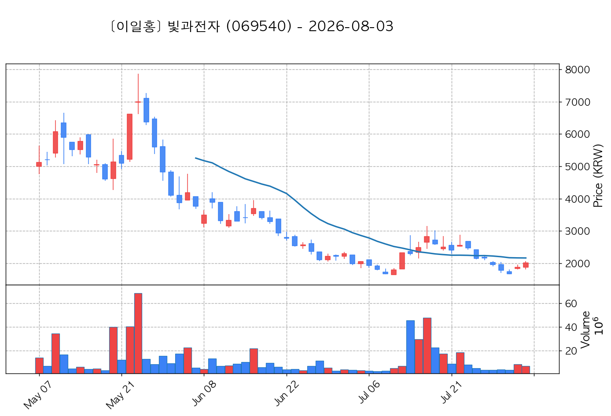
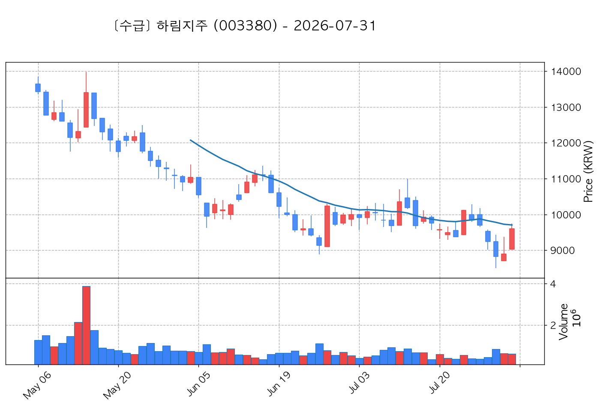

# 📈 [실전플랜 1] 2026-11-02 매매 후보 스크리닝 보고서

> 스크리닝 기준일: 2026-11-02 | [📊 익일 매매 성과 피드백 보고서 보기](./2026-11-02_피드백.html)

---

## 📊 1. 스크리닝 성과 요약

| 전략 | 주요 기법 | 종목수(TOP) |
| :--- | :--- | :---: |
| **전략 1** | 양음양 눌림목 & 사윗감 | 12개 (TOP 3개) |
| **전략 2** | 매집봉 & 이일홍 | 14개 (TOP 1개) |
| **전략 3** | 수급 & 핥 | 0개 (TOP 0개) |
| **합계** | **3대 핵심 전략 통합** | **26개 (TOP 4개)** |

---

## 🔵 3. 전략 1 — 양-음-양 눌림목 (3% × 3슬롯)

### 📋 전략 1 요약표 (상위 10개)

| 종목명 | 기준일종가 | 기준봉 | 지지선 | 비고 및 선정 상태 |
| :--- | ---: | :--- | :---: | :--- |
| **빛과전자** (069540) | 3,980원 | +20.9% 장대양봉 | 3일선 | **★ TOP 1 선택** (사윗감) |
| **광전자** (017900) | 9,000원 | +19.7% 장대양봉 | 3일선 | **★ TOP 2 선택** |
| **빛샘전자** (072950) | 14,130원 | +18.7% 장대양봉 | 8일선 | **★ TOP 3 선택** (사윗감) |
| **앤로보틱스** (138360) | 1,729원 | +20.1% 장대양봉 | 13일선 | 후보군 (1위) |
| **디아이** (003160) | 41,450원 | +15.8% 장대양봉 | 3일선 | 후보군 (2위) |
| **샌즈랩** (411080) | 7,400원 | +16.4% 장대양봉 | 8일선 | 후보군 (3위) (사윗감) |
| **지투지바이오** (456160) | 36,000원 | +18.8% 장대양봉 | 3일선 | 후보군 (4위) |
| **루닛** (328130) | 15,580원 | 상한가 | 3일선 | 후보군 (5위) (사윗감) |
| **양지사** (030960) | 6,340원 | +15.1% 장대양봉 | 3일선 | 후보군 (6위) (사윗감) |
| **상지건설** (042940) | 6,400원 | 상한가 | 3일선 | 후보군 (7위) (사윗감) |

---

### 🔍 전략 1 상세 분석

#### 1) 빛과전자 (069540) — ★ TOP 1 선택 (사윗감)

- **기준 종가**: 3,980원 | **거래대금**: 330억
- **분석 사유**: 🔥[20선 이탈 반등] 과거 2026-10-28 기준봉 후 현재 3일선 지지

#### 2) 광전자 (017900) — ★ TOP 2 선택

- **기준 종가**: 9,000원 | **거래대금**: 301억
- **분석 사유**: 🚨[매물대 저항] 과거 2026-10-29 기준봉 후 현재 3일선 지지

#### 3) 빛샘전자 (072950) — ★ TOP 3 선택 (사윗감)

- **기준 종가**: 14,130원 | **거래대금**: 109억
- **분석 사유**: 🔥[20선 이탈 반등] 과거 2026-10-28 기준봉 후 현재 8일선 지지

#### 4) 앤로보틱스 (138360) — 후보군 (1위)

- **기준 종가**: 1,729원 | **거래대금**: 61억
- **분석 사유**: 과거 2026-10-23 기준봉 후 현재 13일선 지지

#### 5) 디아이 (003160) — 후보군 (2위)

- **기준 종가**: 41,450원 | **거래대금**: 469억
- **분석 사유**: [쌍바닥참고] 과거 2026-10-28 기준봉 후 현재 3일선 지지

#### 6) 샌즈랩 (411080) — 후보군 (3위) (사윗감)

- **기준 종가**: 7,400원 | **거래대금**: 63억
- **분석 사유**: [쌍바닥참고] 과거 2026-10-27 기준봉 후 현재 8일선 지지

#### 7) 지투지바이오 (456160) — 후보군 (4위)

- **기준 종가**: 36,000원 | **거래대금**: 97억
- **분석 사유**: 🚨[매물대 저항] 🔥[20선 이탈 반등] 과거 2026-10-23 기준봉 후 현재 3일선 지지

#### 8) 루닛 (328130) — 후보군 (5위) (사윗감)

- **기준 종가**: 15,580원 | **거래대금**: 206억
- **분석 사유**: 과거 2026-10-26 기준봉 후 현재 3일선 지지

#### 9) 양지사 (030960) — 후보군 (6위) (사윗감)

- **기준 종가**: 6,340원 | **거래대금**: 64억
- **분석 사유**: 과거 2026-10-29 기준봉 후 현재 3일선 지지

#### 10) 상지건설 (042940) — 후보군 (7위) (사윗감)

- **기준 종가**: 6,400원 | **거래대금**: 54억
- **분석 사유**: 과거 2026-10-29 기준봉 후 현재 3일선 지지

## 🟡 4. 전략 2 — 일일봉 매집봉 (10% × 1슬롯)

### 📋 전략 2 요약표 (상위 10개)

| 종목명 | 기준일종가 | 기준봉 | 지지선 | 비고 및 선정 상태 |
| :--- | ---: | :--- | :---: | :--- |
| **LG씨엔에스** (064400) | 78,000원 | ★ [1순위 키움정석] 40일 최고가 근접 + 60일선 상승 + 시가대비 +9.1% 속양봉 | 240일선 | **★ TOP 1 선택** |
| **현대글로비스** (086280) | 206,000원 | ★ [1순위 키움정석] 40일 최고가 근접 + 60일선 상승 + 시가대비 +12.6% 속양봉 | 240일선 | 후보군 (1위) |
| **워트** (396470) | 7,720원 | ★ [1순위 키움정석] 40일 최고가 근접 + 60일선 상승 + 시가대비 +31.7% 속양봉 | 240일선 | 후보군 (2위) |
| **피앤에스로보틱스** (460940) | 5,480원 | ★ [1순위 키움정석] 40일 최고가 근접 + 60일선 상승 + 시가대비 +27.3% 속양봉 | 240일선 | 후보군 (3위) |
| **에어레인** (163280) | 4,565원 | ★ [1순위 키움정석] 40일 최고가 근접 + 60일선 상승 + 시가대비 +30.4% 속양봉 | 240일선 | 후보군 (4위) |
| **리브스메드** (491000) | 43,000원 | ★ [1순위 키움정석] 40일 최고가 근접 + 60일선 상승 + 시가대비 +12.4% 속양봉 | 240일선 | 후보군 (5위) |
| **태광** (023160) | 29,450원 | ★ [1순위 키움정석] 40일 최고가 근접 + 60일선 상승 + 시가대비 +15.0% 속양봉 | 240일선 | 후보군 (6위) |
| **대한해운** (005880) | 2,085원 | ★ [1순위 키움정석] 40일 최고가 근접 + 60일선 상승 + 시가대비 +10.3% 속양봉 | 240일선 | 후보군 (7위) |
| **에코프로에이치엔** (383310) | 26,300원 | ★ [1순위 키움정석] 40일 최고가 근접 + 60일선 상승 + 시가대비 +12.9% 속양봉 | 240일선 | 후보군 (8위) |
| **하림지주** (003380) | 11,940원 | ★ [1순위 키움정석] 40일 최고가 근접 + 60일선 상승 + 시가대비 +6.1% 속양봉 | 240일선 | 후보군 (9위) |

---

### 🔍 전략 2 상세 분석

#### 1) LG씨엔에스 (064400) — ★ TOP 1 선택

- **기준 종가**: 78,000원 | **거래대금**: 775억
- **분석 사유**: ★ [1순위 키움정석] 40일 최고가 근접 + 60일선 상승 + 시가대비 +9.1% 속양봉
- **증권사 리포트**: 삼성(+4.7%)

#### 2) 현대글로비스 (086280) — 후보군 (1위)

- **기준 종가**: 206,000원 | **거래대금**: 697억
- **분석 사유**: ★ [1순위 키움정석] 40일 최고가 근접 + 60일선 상승 + 시가대비 +12.6% 속양봉

#### 3) 워트 (396470) — 후보군 (2위)

- **기준 종가**: 7,720원 | **거래대금**: 374억
- **분석 사유**: ★ [1순위 키움정석] 40일 최고가 근접 + 60일선 상승 + 시가대비 +31.7% 속양봉

#### 4) 피앤에스로보틱스 (460940) — 후보군 (3위)

- **기준 종가**: 5,480원 | **거래대금**: 203억
- **분석 사유**: ★ [1순위 키움정석] 40일 최고가 근접 + 60일선 상승 + 시가대비 +27.3% 속양봉

#### 5) 에어레인 (163280) — 후보군 (4위)

- **기준 종가**: 4,565원 | **거래대금**: 172억
- **분석 사유**: ★ [1순위 키움정석] 40일 최고가 근접 + 60일선 상승 + 시가대비 +30.4% 속양봉

#### 6) 리브스메드 (491000) — 후보군 (5위)

- **기준 종가**: 43,000원 | **거래대금**: 131억
- **분석 사유**: ★ [1순위 키움정석] 40일 최고가 근접 + 60일선 상승 + 시가대비 +12.4% 속양봉

#### 7) 태광 (023160) — 후보군 (6위)

- **기준 종가**: 29,450원 | **거래대금**: 115억
- **분석 사유**: ★ [1순위 키움정석] 40일 최고가 근접 + 60일선 상승 + 시가대비 +15.0% 속양봉

#### 8) 대한해운 (005880) — 후보군 (7위)

- **기준 종가**: 2,085원 | **거래대금**: 72억
- **분석 사유**: ★ [1순위 키움정석] 40일 최고가 근접 + 60일선 상승 + 시가대비 +10.3% 속양봉

#### 9) 에코프로에이치엔 (383310) — 후보군 (8위)

- **기준 종가**: 26,300원 | **거래대금**: 65억
- **분석 사유**: ★ [1순위 키움정석] 40일 최고가 근접 + 60일선 상승 + 시가대비 +12.9% 속양봉

#### 10) 하림지주 (003380) — 후보군 (9위)

- **기준 종가**: 11,940원 | **거래대금**: 62억
- **분석 사유**: ★ [1순위 키움정석] 40일 최고가 근접 + 60일선 상승 + 시가대비 +6.1% 속양봉

## 🟢 5. 전략 3 — 수급 낙폭과대 바닥형 (10% × 2슬롯)

해당 전략 포착 종목 없음

