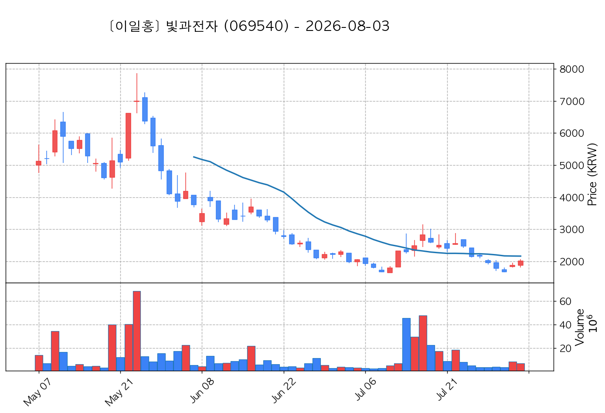
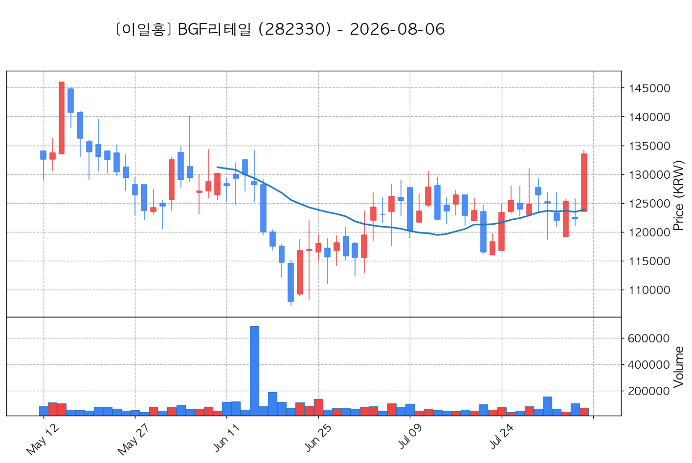

# 📈 [실전플랜 1] 2026-11-03 매매 후보 스크리닝 보고서

> 스크리닝 기준일: 2026-11-03 | [📊 익일 매매 성과 피드백 보고서 보기](./2026-11-03_피드백.html)

---

## 📊 1. 스크리닝 성과 요약

| 전략 | 주요 기법 | 종목수(TOP) |
| :--- | :--- | :---: |
| **전략 1** | 양음양 눌림목 & 사윗감 | 13개 (TOP 3개) |
| **전략 2** | 매집봉 & 이일홍 | 7개 (TOP 1개) |
| **전략 3** | 수급 & 핥 | 0개 (TOP 0개) |
| **합계** | **3대 핵심 전략 통합** | **20개 (TOP 4개)** |

---

## 🔵 3. 전략 1 — 양-음-양 눌림목 (3% × 3슬롯)

### 📋 전략 1 요약표 (상위 10개)

| 종목명 | 기준일종가 | 기준봉 | 지지선 | 비고 및 선정 상태 |
| :--- | ---: | :--- | :---: | :--- |
| **안랩** (053800) | 115,500원 | +22.3% 장대양봉 | 3일선 | **★ TOP 1 선택** |
| **빛과전자** (069540) | 3,760원 | +20.9% 장대양봉 | 8일선 | **★ TOP 2 선택** (사윗감) |
| **광전자** (017900) | 8,850원 | +19.7% 장대양봉 | 3일선 | **★ TOP 3 선택** |
| **한화비전** (489790) | 47,750원 | +21.5% 장대양봉 | 5일선 | 후보군 (1위) (사윗감) |
| **루닛** (328130) | 15,340원 | 상한가 | 3일선 | 후보군 (2위) (사윗감) |
| **엑시콘** (092870) | 52,900원 | +17.2% 장대양봉 | 20일선 | 후보군 (3위) |
| **양지사** (030960) | 6,080원 | +15.1% 장대양봉 | 5일선 | 후보군 (4위) (사윗감) |
| **워트** (396470) | 7,270원 | 상한가 | 3일선 | 후보군 (5위) |
| **SGA솔루션즈** (184230) | 2,960원 | 상한가 | 3일선 | 후보군 (6위) |
| **상지건설** (042940) | 5,350원 | 상한가 | 8일선 | 후보군 (7위) (사윗감) |

---

### 🔍 전략 1 상세 분석

#### 1) 안랩 (053800) — ★ TOP 1 선택

- **기준 종가**: 115,500원 | **거래대금**: 1300억
- **분석 사유**: 과거 2026-10-30 기준봉 후 현재 3일선 지지

#### 2) 빛과전자 (069540) — ★ TOP 2 선택 (사윗감)

- **기준 종가**: 3,760원 | **거래대금**: 179억
- **분석 사유**: 🔥[20선 이탈 반등] 과거 2026-10-28 기준봉 후 현재 8일선 지지

#### 3) 광전자 (017900) — ★ TOP 3 선택

- **기준 종가**: 8,850원 | **거래대금**: 215억
- **분석 사유**: 🚨[매물대 저항] 과거 2026-10-29 기준봉 후 현재 3일선 지지

#### 4) 한화비전 (489790) — 후보군 (1위) (사윗감)

- **기준 종가**: 47,750원 | **거래대금**: 146억
- **분석 사유**: 과거 2026-10-29 기준봉 후 현재 5일선 지지

#### 5) 루닛 (328130) — 후보군 (2위) (사윗감)

- **기준 종가**: 15,340원 | **거래대금**: 283억
- **분석 사유**: 과거 2026-10-26 기준봉 후 현재 3일선 지지

#### 6) 엑시콘 (092870) — 후보군 (3위)

- **기준 종가**: 52,900원 | **거래대금**: 309억
- **분석 사유**: 🔥[20선 이탈 반등] 과거 2026-10-28 기준봉 후 현재 20일선 지지

#### 7) 양지사 (030960) — 후보군 (4위) (사윗감)

- **기준 종가**: 6,080원 | **거래대금**: 118억
- **분석 사유**: 🚨[매물대 저항] 과거 2026-10-29 기준봉 후 현재 5일선 지지

#### 8) 워트 (396470) — 후보군 (5위)

- **기준 종가**: 7,270원 | **거래대금**: 346억
- **분석 사유**: 🌪️ [C타입 갭상승털기] 기준봉 익일 갭상승 후 음봉 손바꿈 (기준봉 50% 사수)

#### 9) SGA솔루션즈 (184230) — 후보군 (6위)

- **기준 종가**: 2,960원 | **거래대금**: 141억
- **분석 사유**: 🚨[매물대 저항] 과거 2026-11-02 기준봉 후 현재 3일선 지지

#### 10) 상지건설 (042940) — 후보군 (7위) (사윗감)

- **기준 종가**: 5,350원 | **거래대금**: 26억
- **분석 사유**: 🚨[매물대 저항] 과거 2026-10-29 기준봉 후 현재 8일선 지지

## 🟡 4. 전략 2 — 일일봉 매집봉 (10% × 1슬롯)

### 📋 전략 2 요약표 (상위 7개)

| 종목명 | 기준일종가 | 기준봉 | 지지선 | 비고 및 선정 상태 |
| :--- | ---: | :--- | :---: | :--- |
| **AP위성** (211270) | 9,510원 | ★ [1순위 키움정석] 40일 최고가 근접 + 60일선 상승 + 시가대비 +20.1% 속양봉 | 240일선 | **★ TOP 1 선택** |
| **아시아나IDT** (267850) | 10,650원 | ★ [1순위 키움정석] 40일 최고가 근접 + 60일선 상승 + 시가대비 +18.5% 속양봉 | 240일선 | 후보군 (1위) |
| **BGF리테일** (282330) | 144,700원 | ★ [1순위 키움정석] 40일 최고가 근접 + 60일선 상승 + 시가대비 +6.0% 속양봉 | 240일선 | 후보군 (2위) |
| **한싹** (430690) | 3,600원 | ★ [1순위 키움정석] 40일 최고가 근접 + 60일선 상승 + 시가대비 +26.1% 속양봉 | 240일선 | 후보군 (3위) |
| **현우산업** (092300) | 2,735원 | ★ [1순위 키움정석] 40일 최고가 근접 + 60일선 상승 + 시가대비 +14.0% 속양봉 | 240일선 | 후보군 (4위) |
| **드림시큐리티** (203650) | 2,210원 | 과거 2026-09-14 매집봉 ➔ 240일선 근접 지지 (+1.48%) | 240일선 | 후보군 (5위) |
| **삼화전기** (009470) | 33,050원 | 과거 2026-09-11 매집봉 ➔ 240일선 근접 지지 (+0.19%) | 240일선 | 후보군 (6위) |

---

### 🔍 전략 2 상세 분석

#### 1) AP위성 (211270) — ★ TOP 1 선택

- **기준 종가**: 9,510원 | **거래대금**: 530억
- **분석 사유**: ★ [1순위 키움정석] 40일 최고가 근접 + 60일선 상승 + 시가대비 +20.1% 속양봉

#### 2) 아시아나IDT (267850) — 후보군 (1위)

- **기준 종가**: 10,650원 | **거래대금**: 335억
- **분석 사유**: ★ [1순위 키움정석] 40일 최고가 근접 + 60일선 상승 + 시가대비 +18.5% 속양봉

#### 3) BGF리테일 (282330) — 후보군 (2위)

- **기준 종가**: 144,700원 | **거래대금**: 106억
- **분석 사유**: ★ [1순위 키움정석] 40일 최고가 근접 + 60일선 상승 + 시가대비 +6.0% 속양봉

#### 4) 한싹 (430690) — 후보군 (3위)

- **기준 종가**: 3,600원 | **거래대금**: 89억
- **분석 사유**: ★ [1순위 키움정석] 40일 최고가 근접 + 60일선 상승 + 시가대비 +26.1% 속양봉

#### 5) 현우산업 (092300) — 후보군 (4위)

- **기준 종가**: 2,735원 | **거래대금**: 59억
- **분석 사유**: ★ [1순위 키움정석] 40일 최고가 근접 + 60일선 상승 + 시가대비 +14.0% 속양봉

#### 6) 드림시큐리티 (203650) — 후보군 (5위)

- **기준 종가**: 2,210원 | **거래대금**: 76억
- **분석 사유**: 과거 2026-09-14 매집봉 ➔ 240일선 근접 지지 (+1.48%)

#### 7) 삼화전기 (009470) — 후보군 (6위)

- **기준 종가**: 33,050원 | **거래대금**: 67억
- **분석 사유**: 과거 2026-09-11 매집봉 ➔ 240일선 근접 지지 (+0.19%)

## 🟢 5. 전략 3 — 수급 낙폭과대 바닥형 (10% × 2슬롯)

해당 전략 포착 종목 없음

