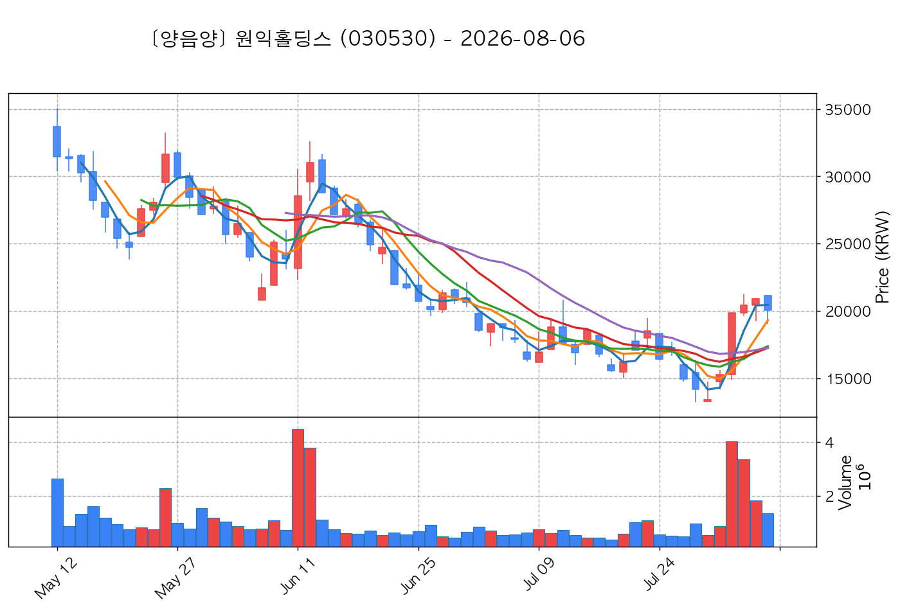
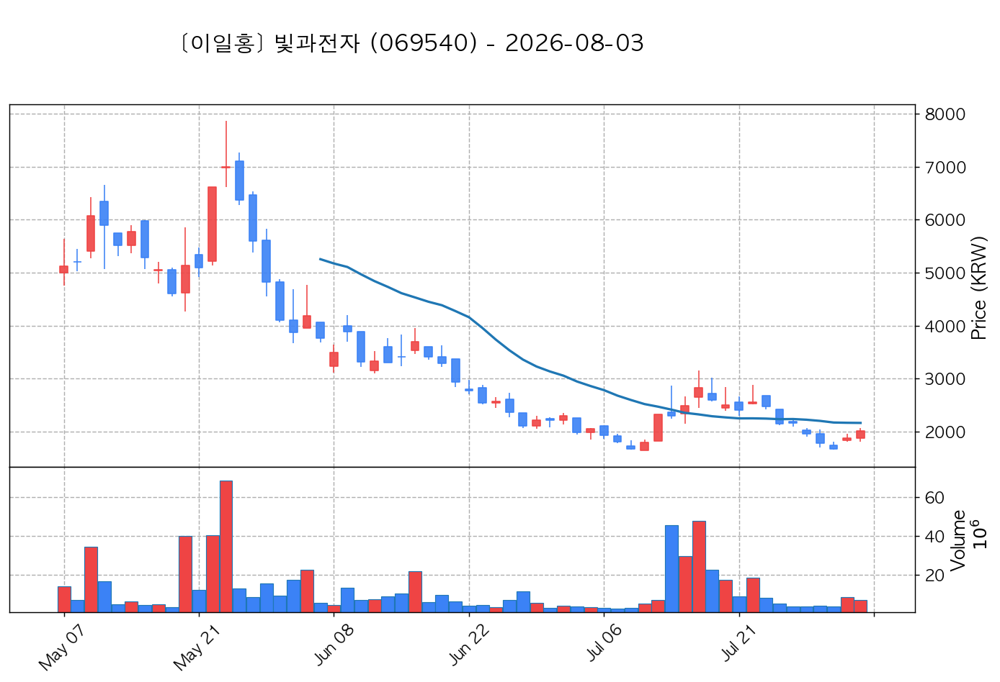

# 📈 [실전플랜 1] 2026-11-04 매매 후보 스크리닝 보고서

> 스크리닝 기준일: 2026-11-04 | [📊 익일 매매 성과 피드백 보고서 보기](./2026-11-04_피드백.html)

---

## 📊 1. 스크리닝 성과 요약

| 전략 | 주요 기법 | 종목수(TOP) |
| :--- | :--- | :---: |
| **전략 1** | 양음양 눌림목 & 사윗감 | 12개 (TOP 3개) |
| **전략 2** | 매집봉 & 이일홍 | 8개 (TOP 1개) |
| **전략 3** | 수급 & 핥 | 0개 (TOP 0개) |
| **합계** | **3대 핵심 전략 통합** | **20개 (TOP 4개)** |

---

## 🔵 3. 전략 1 — 양-음-양 눌림목 (3% × 3슬롯)

### 📋 전략 1 요약표 (상위 10개)

| 종목명 | 기준일종가 | 기준봉 | 지지선 | 비고 및 선정 상태 |
| :--- | ---: | :--- | :---: | :--- |
| **원익홀딩스** (030530) | 30,050원 | +15.4% 장대양봉 | 5일선 | **★ TOP 1 선택** |
| **안랩** (053800) | 99,100원 | +22.3% 장대양봉 | 13일선 | **★ TOP 2 선택** |
| **빛과전자** (069540) | 3,895원 | +20.9% 장대양봉 | 3일선 | **★ TOP 3 선택** (사윗감) |
| **광전자** (017900) | 8,940원 | +19.7% 장대양봉 | 3일선 | 후보군 (1위) |
| **AP위성** (211270) | 10,150원 | 상한가 | 3일선 | 후보군 (2위) |
| **엑시콘** (092870) | 54,300원 | +17.2% 장대양봉 | 3일선 | 후보군 (3위) |
| **양지사** (030960) | 5,970원 | +15.1% 장대양봉 | 3일선 | 후보군 (4위) (사윗감) |
| **파수AI** (150900) | 4,890원 | +17.8% 장대양봉 | 3일선 | 후보군 (5위) |
| **SGA솔루션즈** (184230) | 2,750원 | 상한가 | 5일선 | 후보군 (6위) (사윗감) |
| **샘표식품** (248170) | 23,250원 | 상한가 | 5일선 | 후보군 (7위) |

---

### 🔍 전략 1 상세 분석

#### 1) 원익홀딩스 (030530) — ★ TOP 1 선택

- **기준 종가**: 30,050원 | **거래대금**: 1510억
- **분석 사유**: 과거 2026-10-28 기준봉 후 현재 5일선 지지

#### 2) 안랩 (053800) — ★ TOP 2 선택

- **기준 종가**: 99,100원 | **거래대금**: 502억
- **분석 사유**: 🚨[매물대 저항] 과거 2026-10-30 기준봉 후 현재 13일선 지지

#### 3) 빛과전자 (069540) — ★ TOP 3 선택 (사윗감)

- **기준 종가**: 3,895원 | **거래대금**: 330억
- **분석 사유**: 🔥[20선 이탈 반등] 과거 2026-10-28 기준봉 후 현재 3일선 지지

#### 4) 광전자 (017900) — 후보군 (1위)

- **기준 종가**: 8,940원 | **거래대금**: 514억
- **분석 사유**: 🚨[매물대 저항] [쌍바닥참고] 과거 2026-10-29 기준봉 후 현재 3일선 지지

#### 5) AP위성 (211270) — 후보군 (2위)

- **기준 종가**: 10,150원 | **거래대금**: 597억
- **분석 사유**: 🌪️ [C타입 갭상승털기] 기준봉 익일 갭상승 후 음봉 손바꿈 (기준봉 50% 사수)

#### 6) 엑시콘 (092870) — 후보군 (3위)

- **기준 종가**: 54,300원 | **거래대금**: 405억
- **분석 사유**: 🔥[20선 이탈 반등] 과거 2026-10-28 기준봉 후 현재 3일선 지지

#### 7) 양지사 (030960) — 후보군 (4위) (사윗감)

- **기준 종가**: 5,970원 | **거래대금**: 231억
- **분석 사유**: 🚨[매물대 저항] [쌍바닥참고] 과거 2026-10-29 기준봉 후 현재 3일선 지지

#### 8) 파수AI (150900) — 후보군 (5위)

- **기준 종가**: 4,890원 | **거래대금**: 76억
- **분석 사유**: 🚨[매물대 저항] 과거 2026-11-03 기준봉 후 현재 3일선 지지

#### 9) SGA솔루션즈 (184230) — 후보군 (6위) (사윗감)

- **기준 종가**: 2,750원 | **거래대금**: 71억
- **분석 사유**: 🚨[매물대 저항] 과거 2026-11-02 기준봉 후 현재 5일선 지지

#### 10) 샘표식품 (248170) — 후보군 (7위)

- **기준 종가**: 23,250원 | **거래대금**: 55억
- **분석 사유**: 🚨[매물대 저항] 과거 2026-11-02 기준봉 후 현재 5일선 지지

## 🟡 4. 전략 2 — 일일봉 매집봉 (10% × 1슬롯)

### 📋 전략 2 요약표 (상위 8개)

| 종목명 | 기준일종가 | 기준봉 | 지지선 | 비고 및 선정 상태 |
| :--- | ---: | :--- | :---: | :--- |
| **셀트리온** (068270) | 200,500원 | ★ [1순위 키움정석] 40일 최고가 근접 + 60일선 상승 + 시가대비 +5.1% 속양봉 | 240일선 | **★ TOP 1 선택** |
| **LG유플러스** (032640) | 15,620원 | ★ [1순위 키움정석] 40일 최고가 근접 + 60일선 상승 + 시가대비 +8.9% 속양봉 | 240일선 | 후보군 (1위) |
| **루닛** (328130) | 14,890원 | 과거 2026-09-28 매집봉 ➔ 240일선 근접 지지 (-2.26%) | 240일선 | 후보군 (2위) |
| **HLB바이오스텝** (278650) | 5,140원 | 과거 2026-09-15 매집봉 ➔ 240일선 근접 지지 (+0.64%) | 240일선 | 후보군 (3위) |
| **아이씨티케이** (456010) | 17,660원 | 과거 2026-09-11 매집봉 ➔ 240일선 근접 지지 (-2.07%) | 240일선 | 후보군 (4위) |
| **삼화전기** (009470) | 33,000원 | 과거 2026-09-11 매집봉 ➔ 240일선 근접 지지 (+0.05%) | 240일선 | 후보군 (5위) |
| **샌즈랩** (411080) | 6,370원 | 과거 2026-09-15 매집봉 ➔ 240일선 근접 지지 (+2.64%) | 240일선 | 후보군 (6위) |
| **드림시큐리티** (203650) | 2,135원 | 과거 2026-09-14 매집봉 ➔ 240일선 근접 지지 (-2.02%) | 240일선 | 후보군 (7위) |

---

### 🔍 전략 2 상세 분석

#### 1) 셀트리온 (068270) — ★ TOP 1 선택

- **기준 종가**: 200,500원 | **거래대금**: 1834억
- **분석 사유**: ★ [1순위 키움정석] 40일 최고가 근접 + 60일선 상승 + 시가대비 +5.1% 속양봉
- **증권사 리포트**: 유안타(+14.3%) / KB(+11.1%)

#### 2) LG유플러스 (032640) — 후보군 (1위)

- **기준 종가**: 15,620원 | **거래대금**: 482억
- **분석 사유**: ★ [1순위 키움정석] 40일 최고가 근접 + 60일선 상승 + 시가대비 +8.9% 속양봉

#### 3) 루닛 (328130) — 후보군 (2위)

- **기준 종가**: 14,890원 | **거래대금**: 213억
- **분석 사유**: 과거 2026-09-28 매집봉 ➔ 240일선 근접 지지 (-2.26%)

#### 4) HLB바이오스텝 (278650) — 후보군 (3위)

- **기준 종가**: 5,140원 | **거래대금**: 132억
- **분석 사유**: 과거 2026-09-15 매집봉 ➔ 240일선 근접 지지 (+0.64%)

#### 5) 아이씨티케이 (456010) — 후보군 (4위)

- **기준 종가**: 17,660원 | **거래대금**: 112억
- **분석 사유**: 과거 2026-09-11 매집봉 ➔ 240일선 근접 지지 (-2.07%)

#### 6) 삼화전기 (009470) — 후보군 (5위)

- **기준 종가**: 33,000원 | **거래대금**: 49억
- **분석 사유**: 과거 2026-09-11 매집봉 ➔ 240일선 근접 지지 (+0.05%)

#### 7) 샌즈랩 (411080) — 후보군 (6위)

- **기준 종가**: 6,370원 | **거래대금**: 46억
- **분석 사유**: 과거 2026-09-15 매집봉 ➔ 240일선 근접 지지 (+2.64%)

#### 8) 드림시큐리티 (203650) — 후보군 (7위)

- **기준 종가**: 2,135원 | **거래대금**: 36억
- **분석 사유**: 과거 2026-09-14 매집봉 ➔ 240일선 근접 지지 (-2.02%)

## 🟢 5. 전략 3 — 수급 낙폭과대 바닥형 (10% × 2슬롯)

해당 전략 포착 종목 없음

