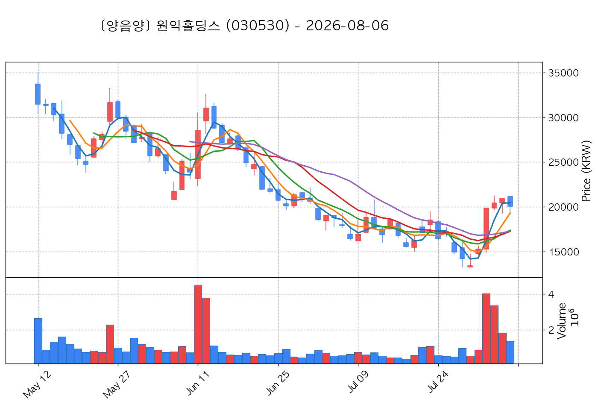
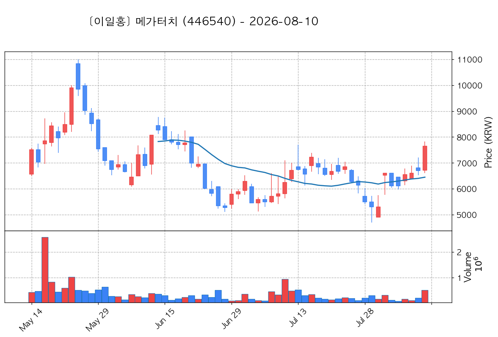

# 📈 [실전플랜 1] 2026-11-05 매매 후보 스크리닝 보고서

> 스크리닝 기준일: 2026-11-05 | [📊 익일 매매 성과 피드백 보고서 보기](./2026-11-05_피드백.html)

---

## 📊 1. 스크리닝 성과 요약

| 전략 | 주요 기법 | 종목수(TOP) |
| :--- | :--- | :---: |
| **전략 1** | 양음양 눌림목 & 사윗감 | 11개 (TOP 3개) |
| **전략 2** | 매집봉 & 이일홍 | 6개 (TOP 1개) |
| **전략 3** | 수급 & 핥 | 0개 (TOP 0개) |
| **합계** | **3대 핵심 전략 통합** | **17개 (TOP 4개)** |

---

## 🔵 3. 전략 1 — 양-음-양 눌림목 (3% × 3슬롯)

### 📋 전략 1 요약표 (상위 10개)

| 종목명 | 기준일종가 | 기준봉 | 지지선 | 비고 및 선정 상태 |
| :--- | ---: | :--- | :---: | :--- |
| **한화솔루션** (009830) | 26,600원 | +18.6% 장대양봉 | 3일선 | **★ TOP 1 선택** |
| **원익홀딩스** (030530) | 26,650원 | +15.4% 장대양봉 | 13일선 | **★ TOP 2 선택** |
| **안랩** (053800) | 98,100원 | +22.3% 장대양봉 | 13일선 | **★ TOP 3 선택** |
| **AP위성** (211270) | 9,140원 | 상한가 | 5일선 | 후보군 (1위) (사윗감) |
| **라온로보틱스** (232680) | 11,240원 | +24.3% 장대양봉 | 8일선 | 후보군 (2위) |
| **양지사** (030960) | 5,750원 | +15.1% 장대양봉 | 3일선 | 후보군 (3위) (사윗감) |
| **파수AI** (150900) | 4,530원 | +17.8% 장대양봉 | 8일선 | 후보군 (4위) |
| **워트** (396470) | 6,220원 | 상한가 | 13일선 | 후보군 (5위) (사윗감) |
| **SGA솔루션즈** (184230) | 2,560원 | 상한가 | 8일선 | 후보군 (6위) (사윗감) |
| **피앤에스로보틱스** (460940) | 4,810원 | 상한가 | 8일선 | 후보군 (7위) (사윗감) |

---

### 🔍 전략 1 상세 분석

#### 1) 한화솔루션 (009830) — ★ TOP 1 선택

- **기준 종가**: 26,600원 | **거래대금**: 3627억
- **분석 사유**: 🚨[매물대 저항] 🔥[20선 이탈 반등] 과거 2026-11-04 기준봉 후 현재 3일선 지지

#### 2) 원익홀딩스 (030530) — ★ TOP 2 선택

- **기준 종가**: 26,650원 | **거래대금**: 752억
- **분석 사유**: [쌍바닥참고] 과거 2026-10-28 기준봉 후 현재 13일선 지지

#### 3) 안랩 (053800) — ★ TOP 3 선택

- **기준 종가**: 98,100원 | **거래대금**: 366억
- **분석 사유**: 🚨[매물대 저항] 과거 2026-10-30 기준봉 후 현재 13일선 지지

#### 4) AP위성 (211270) — 후보군 (1위) (사윗감)

- **기준 종가**: 9,140원 | **거래대금**: 80억
- **분석 사유**: 과거 2026-11-03 기준봉 후 현재 5일선 지지

#### 5) 라온로보틱스 (232680) — 후보군 (2위)

- **기준 종가**: 11,240원 | **거래대금**: 47억
- **분석 사유**: 🚨[매물대 저항] 과거 2026-10-30 기준봉 후 현재 8일선 지지

#### 6) 양지사 (030960) — 후보군 (3위) (사윗감)

- **기준 종가**: 5,750원 | **거래대금**: 126억
- **분석 사유**: 🚨[매물대 저항] 🔥[20선 이탈 반등] 과거 2026-10-29 기준봉 후 현재 3일선 지지

#### 7) 파수AI (150900) — 후보군 (4위)

- **기준 종가**: 4,530원 | **거래대금**: 28억
- **분석 사유**: 🚨[매물대 저항] [쌍바닥참고] 과거 2026-11-03 기준봉 후 현재 8일선 지지

#### 8) 워트 (396470) — 후보군 (5위) (사윗감)

- **기준 종가**: 6,220원 | **거래대금**: 51억
- **분석 사유**: 🚨[매물대 저항] 🔥[20선 이탈 반등] 과거 2026-11-02 기준봉 후 현재 13일선 지지

#### 9) SGA솔루션즈 (184230) — 후보군 (6위) (사윗감)

- **기준 종가**: 2,560원 | **거래대금**: 39억
- **분석 사유**: 🚨[매물대 저항] 과거 2026-11-02 기준봉 후 현재 8일선 지지

#### 10) 피앤에스로보틱스 (460940) — 후보군 (7위) (사윗감)

- **기준 종가**: 4,810원 | **거래대금**: 26억
- **분석 사유**: 🚨[매물대 저항] 과거 2026-11-02 기준봉 후 현재 8일선 지지

## 🟡 4. 전략 2 — 일일봉 매집봉 (10% × 1슬롯)

### 📋 전략 2 요약표 (상위 6개)

| 종목명 | 기준일종가 | 기준봉 | 지지선 | 비고 및 선정 상태 |
| :--- | ---: | :--- | :---: | :--- |
| **에스와이** (109610) | 2,090원 | ★ [1순위 키움정석] 40일 최고가 근접 + 60일선 상승 + 시가대비 +15.3% 속양봉 | 240일선 | **★ TOP 1 선택** |
| **깨끗한나라** (004540) | 1,554원 | ★ [1순위 키움정석] 40일 최고가 근접 + 60일선 상승 + 시가대비 +29.9% 속양봉 | 240일선 | 후보군 (1위) |
| **HLB바이오스텝** (278650) | 5,200원 | 과거 2026-09-15 매집봉 ➔ 240일선 근접 지지 (+1.99%) | 240일선 | 후보군 (2위) |
| **진에어** (272450) | 6,190원 | 과거 2026-10-14 매집봉 ➔ 240일선 근접 지지 (-0.09%) | 240일선 | 후보군 (3위) |
| **메가터치** (446540) | 6,120원 | 과거 2026-09-11 매집봉 ➔ 240일선 근접 지지 (+2.68%) | 240일선 | 후보군 (4위) |
| **심텍홀딩스** (036710) | 3,560원 | 과거 2026-09-22 매집봉 ➔ 240일선 근접 지지 (+1.70%) | 240일선 | 후보군 (5위) |

---

### 🔍 전략 2 상세 분석

#### 1) 에스와이 (109610) — ★ TOP 1 선택

- **기준 종가**: 2,090원 | **거래대금**: 314억
- **분석 사유**: ★ [1순위 키움정석] 40일 최고가 근접 + 60일선 상승 + 시가대비 +15.3% 속양봉

#### 2) 깨끗한나라 (004540) — 후보군 (1위)

- **기준 종가**: 1,554원 | **거래대금**: 94억
- **분석 사유**: ★ [1순위 키움정석] 40일 최고가 근접 + 60일선 상승 + 시가대비 +29.9% 속양봉

#### 3) HLB바이오스텝 (278650) — 후보군 (2위)

- **기준 종가**: 5,200원 | **거래대금**: 105억
- **분석 사유**: 과거 2026-09-15 매집봉 ➔ 240일선 근접 지지 (+1.99%)

#### 4) 진에어 (272450) — 후보군 (3위)

- **기준 종가**: 6,190원 | **거래대금**: 31억
- **분석 사유**: 과거 2026-10-14 매집봉 ➔ 240일선 근접 지지 (-0.09%)

#### 5) 메가터치 (446540) — 후보군 (4위)

- **기준 종가**: 6,120원 | **거래대금**: 30억
- **분석 사유**: 과거 2026-09-11 매집봉 ➔ 240일선 근접 지지 (+2.68%)

#### 6) 심텍홀딩스 (036710) — 후보군 (5위)

- **기준 종가**: 3,560원 | **거래대금**: 24억
- **분석 사유**: 과거 2026-09-22 매집봉 ➔ 240일선 근접 지지 (+1.70%)

## 🟢 5. 전략 3 — 수급 낙폭과대 바닥형 (10% × 2슬롯)

해당 전략 포착 종목 없음

