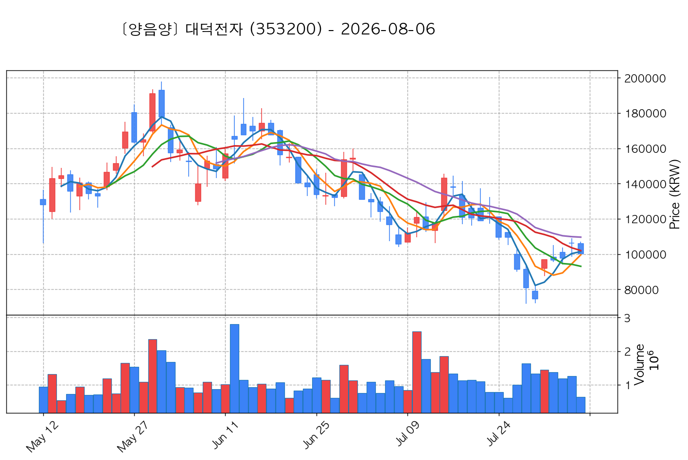
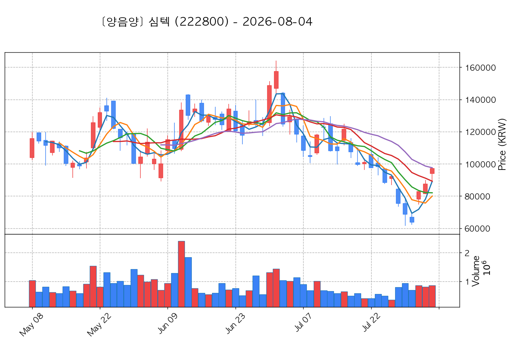
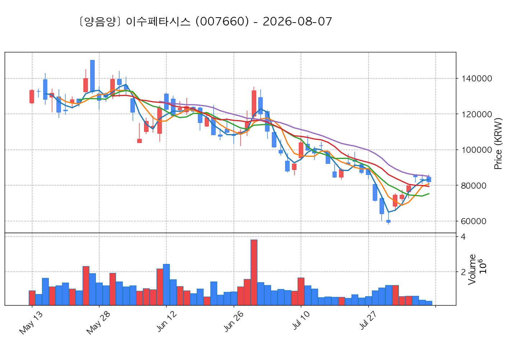
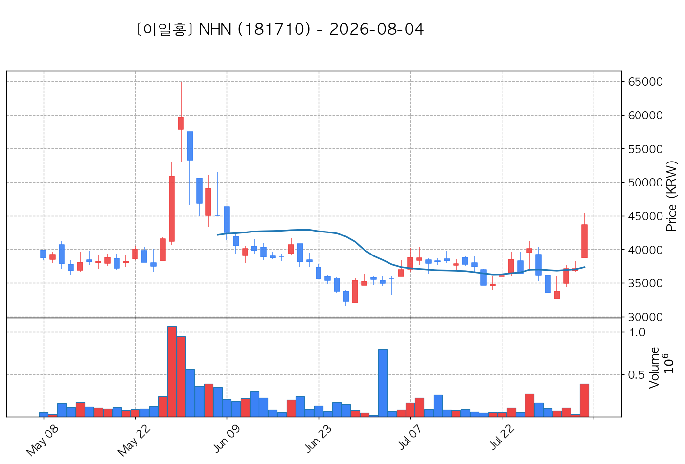
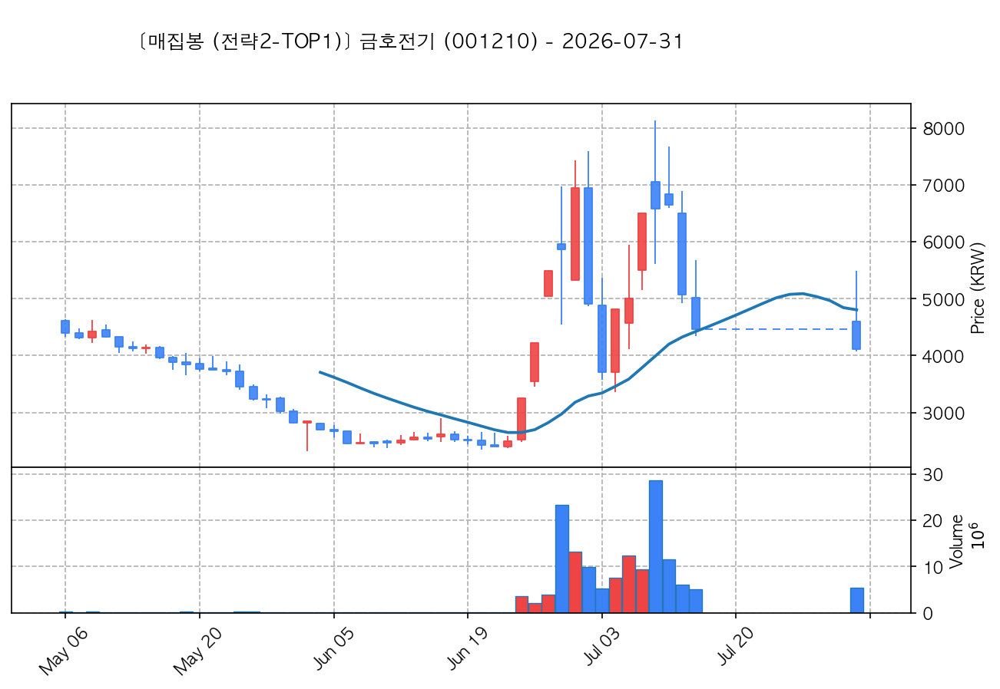
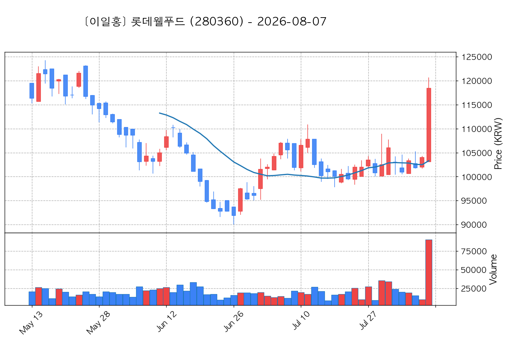

# 📈 [실전플랜 1] 2026-11-16 매매 후보 스크리닝 보고서

> 스크리닝 기준일: 2026-11-16 | [📊 익일 매매 성과 피드백 보고서 보기](./2026-11-16_피드백.html)

---

## 📊 1. 스크리닝 성과 요약

| 전략 | 주요 기법 | 종목수(TOP) |
| :--- | :--- | :---: |
| **전략 1** | 양음양 눌림목 & 사윗감 | 24개 (TOP 3개) |
| **전략 2** | 매집봉 & 이일홍 | 6개 (TOP 1개) |
| **전략 3** | 수급 & 핥 | 1개 (TOP 1개) |
| **합계** | **3대 핵심 전략 통합** | **31개 (TOP 5개)** |

---

## 🔵 3. 전략 1 — 양-음-양 눌림목 (3% × 3슬롯)

### 📋 전략 1 요약표 (상위 10개)

| 종목명 | 기준일종가 | 기준봉 | 지지선 | 비고 및 선정 상태 |
| :--- | ---: | :--- | :---: | :--- |
| **지니언스** (263860) | 34,550원 | +29.1% 장대양봉 | 3일선 | **★ TOP 1 선택** |
| **대덕전자** (353200) | 81,900원 | +18.2% 장대양봉 | 8일선 | **★ TOP 2 선택** (사윗감) |
| **심텍** (222800) | 107,400원 | +17.5% 장대양봉 | 8일선 | **★ TOP 3 선택** |
| **코리아써키트** (007810) | 88,800원 | +29.1% 장대양봉 | 3일선 | 후보군 (1위) |
| **이수페타시스** (007660) | 81,300원 | +21.8% 장대양봉 | 5일선 | 후보군 (2위) |
| **KBI메탈** (024840) | 4,260원 | +25.3% 장대양봉 | 3일선 | 후보군 (3위) |
| **NHN** (181710) | 67,600원 | +27.3% 장대양봉 | 3일선 | 후보군 (4위) (사윗감) |
| **아시아나IDT** (267850) | 13,110원 | +22.3% 장대양봉 | 3일선 | 후보군 (5위) |
| **금호전기** (001210) | 7,270원 | +22.8% 장대양봉 | 3일선 | 후보군 (6위) |
| **진에어** (272450) | 7,820원 | +28.3% 장대양봉 | 3일선 | 후보군 (7위) (사윗감) |

---

### 🔍 전략 1 상세 분석

#### 1) 지니언스 (263860) — ★ TOP 1 선택

- **기준 종가**: 34,550원 | **거래대금**: 1241억
- **분석 사유**: 과거 2026-11-12 기준봉 후 현재 3일선 지지

#### 2) 대덕전자 (353200) — ★ TOP 2 선택 (사윗감)

- **기준 종가**: 81,900원 | **거래대금**: 818억
- **분석 사유**: 🚨[매물대 저항] 🔥[20선 이탈 반등] 과거 2026-11-11 기준봉 후 현재 8일선 지지

#### 3) 심텍 (222800) — ★ TOP 3 선택

- **기준 종가**: 107,400원 | **거래대금**: 932억
- **분석 사유**: 🚨[매물대 저항] 🔥[20선 이탈 반등] 과거 2026-11-11 기준봉 후 현재 8일선 지지

#### 4) 코리아써키트 (007810) — 후보군 (1위)

- **기준 종가**: 88,800원 | **거래대금**: 579억
- **분석 사유**: 과거 2026-11-11 기준봉 후 현재 3일선 지지

#### 5) 이수페타시스 (007660) — 후보군 (2위)

- **기준 종가**: 81,300원 | **거래대금**: 862억
- **분석 사유**: 🚨[매물대 저항] 🔥[20선 이탈 반등] 과거 2026-11-11 기준봉 후 현재 5일선 지지

#### 6) KBI메탈 (024840) — 후보군 (3위)

- **기준 종가**: 4,260원 | **거래대금**: 182억
- **분석 사유**: 🚨[매물대 저항] 🌪️ [C타입 갭상승털기] 기준봉 익일 갭상승 후 음봉 손바꿈 (기준봉 50% 사수)

#### 7) NHN (181710) — 후보군 (4위) (사윗감)

- **기준 종가**: 67,600원 | **거래대금**: 175억
- **분석 사유**: 과거 2026-11-10 기준봉 후 현재 3일선 지지

#### 8) 아시아나IDT (267850) — 후보군 (5위)

- **기준 종가**: 13,110원 | **거래대금**: 344억
- **분석 사유**: 과거 2026-11-10 기준봉 후 현재 3일선 지지

#### 9) 금호전기 (001210) — 후보군 (6위)

- **기준 종가**: 7,270원 | **거래대금**: 264억
- **분석 사유**: 🚨[매물대 저항] 🔥[20선 이탈 반등] 과거 2026-11-13 기준봉 후 현재 3일선 지지

#### 10) 진에어 (272450) — 후보군 (7위) (사윗감)

- **기준 종가**: 7,820원 | **거래대금**: 24억
- **분석 사유**: 과거 2026-11-10 기준봉 후 현재 3일선 지지

## 🟡 4. 전략 2 — 일일봉 매집봉 (10% × 1슬롯)

### 📋 전략 2 요약표 (상위 6개)

| 종목명 | 기준일종가 | 기준봉 | 지지선 | 비고 및 선정 상태 |
| :--- | ---: | :--- | :---: | :--- |
| **아남전자** (008700) | 1,505원 | ★ [1순위 키움정석] 40일 최고가 근접 + 60일선 상승 + 시가대비 +18.5% 속양봉 | 240일선 | **★ TOP 1 선택** |
| **롯데웰푸드** (280360) | 137,800원 | ★ [1순위 키움정석] 40일 최고가 근접 + 60일선 상승 + 시가대비 +8.7% 속양봉 | 240일선 | 후보군 (1위) |
| **삼현** (437730) | 48,650원 | 과거 2026-09-21 매집봉 ➔ 240일선 근접 지지 (+2.80%) | 240일선 | 후보군 (2위) |
| **루닛** (328130) | 14,710원 | 과거 2026-09-28 매집봉 ➔ 240일선 근접 지지 (-2.68%) | 240일선 | 후보군 (3위) |
| **시선AI** (340810) | 3,140원 | 과거 2026-09-21 매집봉 ➔ 240일선 근접 지지 (+2.87%) | 240일선 | 후보군 (4위) |
| **포메탈** (119500) | 3,420원 | 과거 2026-10-26 매집봉 ➔ 240일선 근접 지지 (+1.18%) | 240일선 | 후보군 (5위) |

---

### 🔍 전략 2 상세 분석

#### 1) 아남전자 (008700) — ★ TOP 1 선택

- **기준 종가**: 1,505원 | **거래대금**: 269억
- **분석 사유**: ★ [1순위 키움정석] 40일 최고가 근접 + 60일선 상승 + 시가대비 +18.5% 속양봉

#### 2) 롯데웰푸드 (280360) — 후보군 (1위)

- **기준 종가**: 137,800원 | **거래대금**: 57억
- **분석 사유**: ★ [1순위 키움정석] 40일 최고가 근접 + 60일선 상승 + 시가대비 +8.7% 속양봉

#### 3) 삼현 (437730) — 후보군 (2위)

- **기준 종가**: 48,650원 | **거래대금**: 353억
- **분석 사유**: 과거 2026-09-21 매집봉 ➔ 240일선 근접 지지 (+2.80%)

#### 4) 루닛 (328130) — 후보군 (3위)

- **기준 종가**: 14,710원 | **거래대금**: 193억
- **분석 사유**: 과거 2026-09-28 매집봉 ➔ 240일선 근접 지지 (-2.68%)

#### 5) 시선AI (340810) — 후보군 (4위)

- **기준 종가**: 3,140원 | **거래대금**: 134억
- **분석 사유**: 과거 2026-09-21 매집봉 ➔ 240일선 근접 지지 (+2.87%)

#### 6) 포메탈 (119500) — 후보군 (5위)

- **기준 종가**: 3,420원 | **거래대금**: 35억
- **분석 사유**: 과거 2026-10-26 매집봉 ➔ 240일선 근접 지지 (+1.18%)

## 🟢 5. 전략 3 — 수급 낙폭과대 바닥형 (10% × 2슬롯)

### 📋 전략 3 요약표 (상위 1개)

| 종목명 | 기준일종가 | 기준봉 | 지지선 | 비고 및 선정 상태 |
| :--- | ---: | :--- | :---: | :--- |
| **카카오** (035720) | 32,350원 | 52주 고점 대비 (48.5%) ➔ 20일 메이저 수급 100억+ 유입 ➔ 없음 지지 안착 | 수급선 | **★ TOP 1 선택** |

---

### 🔍 전략 3 상세 분석

#### 1) 카카오 (035720) — ★ TOP 1 선택

- **기준 종가**: 32,350원 | **거래대금**: 414억
- **분석 사유**: 52주 고점 대비 (48.5%) ➔ 20일 메이저 수급 100억+ 유입 ➔ 없음 지지 안착

