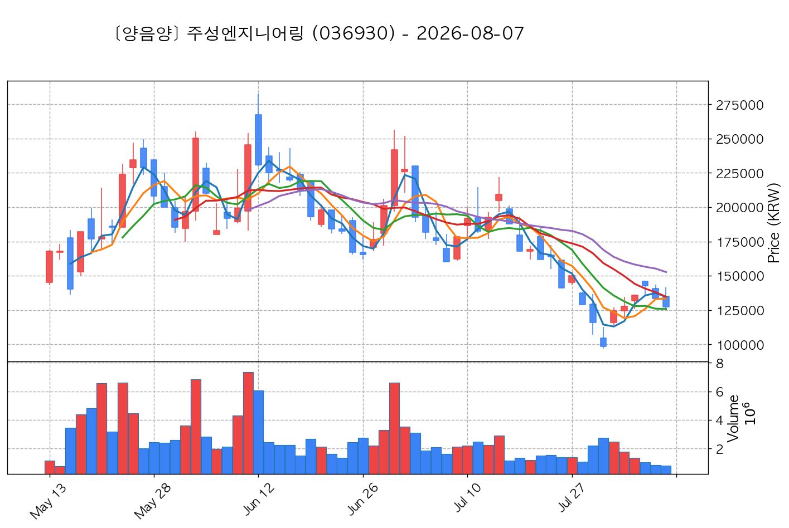
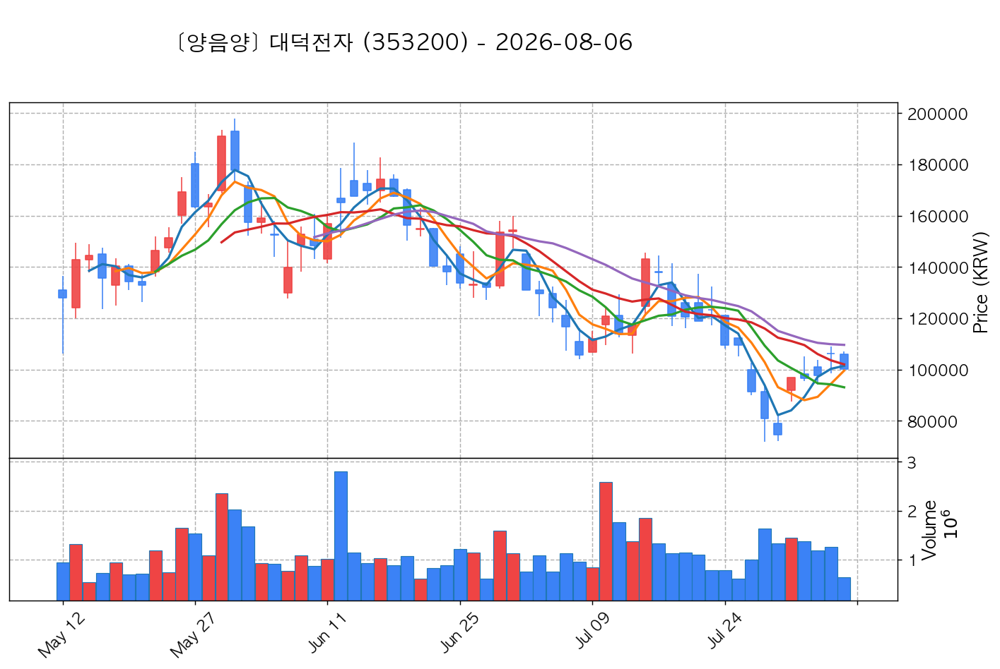
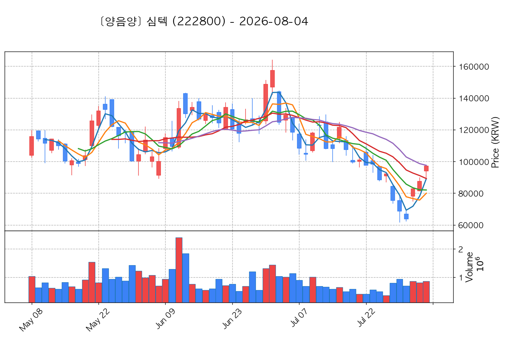
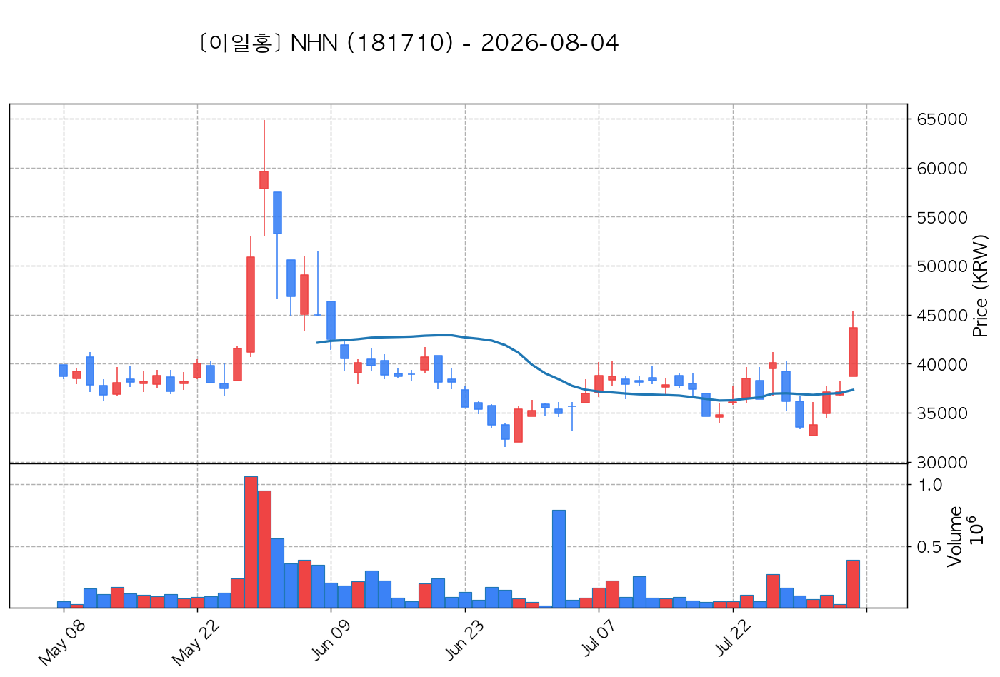
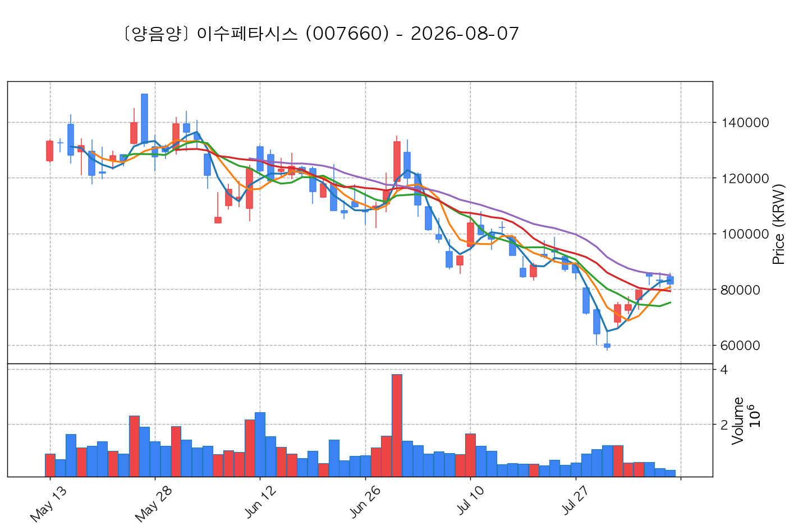
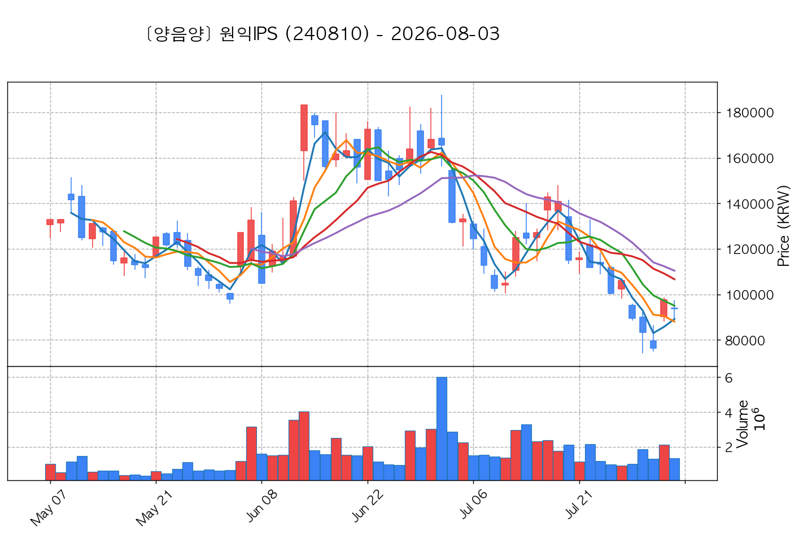
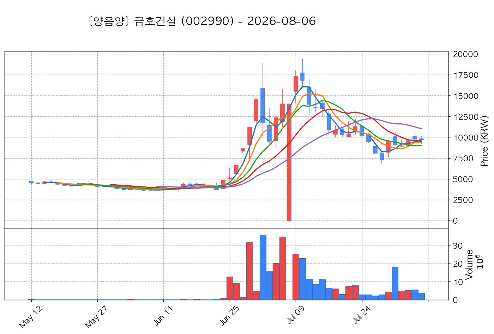

# 📈 [실전플랜 1] 2026-11-19 매매 후보 스크리닝 보고서

> 스크리닝 기준일: 2026-11-19 | [📊 익일 매매 성과 피드백 보고서 보기](./2026-11-19_피드백.html)

---

## 📊 1. 스크리닝 성과 요약

| 전략 | 주요 기법 | 종목수(TOP) |
| :--- | :--- | :---: |
| **전략 1** | 양음양 눌림목 & 사윗감 | 22개 (TOP 3개) |
| **전략 2** | 매집봉 & 이일홍 | 6개 (TOP 1개) |
| **전략 3** | 수급 & 핥 | 0개 (TOP 0개) |
| **합계** | **3대 핵심 전략 통합** | **28개 (TOP 4개)** |

---

## 🔵 3. 전략 1 — 양-음-양 눌림목 (3% × 3슬롯)

### 📋 전략 1 요약표 (상위 10개)

| 종목명 | 기준일종가 | 기준봉 | 지지선 | 비고 및 선정 상태 |
| :--- | ---: | :--- | :---: | :--- |
| **주성엔지니어링** (036930) | 151,800원 | +20.0% 장대양봉 | 3일선 | **★ TOP 1 선택** |
| **지니언스** (263860) | 37,200원 | +29.1% 장대양봉 | 3일선 | **★ TOP 2 선택** |
| **대덕전자** (353200) | 81,700원 | +18.2% 장대양봉 | 3일선 | **★ TOP 3 선택** (사윗감) |
| **심텍** (222800) | 107,700원 | +17.5% 장대양봉 | 3일선 | 후보군 (1위) |
| **JYP Ent.** (035900) | 47,350원 | +23.1% 장대양봉 | 3일선 | 후보군 (2위) |
| **NHN** (181710) | 64,800원 | ADK특 13~20선 반등 | 13일선 (1.15%) | 후보군 (3위) |
| **이수페타시스** (007660) | 81,300원 | +21.8% 장대양봉 | 3일선 | 후보군 (4위) |
| **원익IPS** (240810) | 70,500원 | +20.7% 장대양봉 | 3일선 | 후보군 (5위) |
| **KBI메탈** (024840) | 4,005원 | +25.3% 장대양봉 | 3일선 | 후보군 (6위) |
| **금호건설** (002990) | 10,130원 | +22.5% 장대양봉 | 3일선 | 후보군 (7위) (사윗감) |

---

### 🔍 전략 1 상세 분석

#### 1) 주성엔지니어링 (036930) — ★ TOP 1 선택

- **기준 종가**: 151,800원 | **거래대금**: 1039억
- **분석 사유**: 🚨[매물대 저항] 🔥[20선 이탈 반등] 과거 2026-11-11 기준봉 후 현재 3일선 지지

#### 2) 지니언스 (263860) — ★ TOP 2 선택

- **기준 종가**: 37,200원 | **거래대금**: 860억
- **분석 사유**: 과거 2026-11-12 기준봉 후 현재 3일선 지지

#### 3) 대덕전자 (353200) — ★ TOP 3 선택 (사윗감)

- **기준 종가**: 81,700원 | **거래대금**: 475억
- **분석 사유**: 🚨[매물대 저항] 🔥[20선 이탈 반등] 과거 2026-11-11 기준봉 후 현재 3일선 지지

#### 4) 심텍 (222800) — 후보군 (1위)

- **기준 종가**: 107,700원 | **거래대금**: 699억
- **분석 사유**: 🚨[매물대 저항] 🔥[20선 이탈 반등] 과거 2026-11-11 기준봉 후 현재 3일선 지지

#### 5) JYP Ent. (035900) — 후보군 (2위)

- **기준 종가**: 47,350원 | **거래대금**: 1062억
- **분석 사유**: 과거 2026-11-18 기준봉 후 현재 3일선 지지

#### 6) NHN (181710) — 후보군 (3위)

- **기준 종가**: 64,800원 | **거래대금**: 174억
- **분석 사유**: ★ [ADK특 TOP1] 20봉내 400억+ Envelope상한 돌파 후 13일선 1.15% 이격 초근접 반등

#### 7) 이수페타시스 (007660) — 후보군 (4위)

- **기준 종가**: 81,300원 | **거래대금**: 477억
- **분석 사유**: 🚨[매물대 저항] 🔥[20선 이탈 반등] 과거 2026-11-11 기준봉 후 현재 3일선 지지

#### 8) 원익IPS (240810) — 후보군 (5위)

- **기준 종가**: 70,500원 | **거래대금**: 225억
- **분석 사유**: 🚨[매물대 저항] 🔥[20선 이탈 반등] 과거 2026-11-11 기준봉 후 현재 3일선 지지

#### 9) KBI메탈 (024840) — 후보군 (6위)

- **기준 종가**: 4,005원 | **거래대금**: 43억
- **분석 사유**: 🚨[매물대 저항] 과거 2026-11-13 기준봉 후 현재 3일선 지지

#### 10) 금호건설 (002990) — 후보군 (7위) (사윗감)

- **기준 종가**: 10,130원 | **거래대금**: 79억
- **분석 사유**: 🚨[매물대 저항] 과거 2026-11-13 기준봉 후 현재 3일선 지지
- **증권사 리포트**: 현대차(+163.2%)

## 🟡 4. 전략 2 — 일일봉 매집봉 (10% × 1슬롯)

### 📋 전략 2 요약표 (상위 6개)

| 종목명 | 기준일종가 | 기준봉 | 지지선 | 비고 및 선정 상태 |
| :--- | ---: | :--- | :---: | :--- |
| **에스와이** (109610) | 2,400원 | ★ [1순위 키움정석] 40일 최고가 근접 + 60일선 상승 + 시가대비 +30.0% 속양봉 | 240일선 | **★ TOP 1 선택** |
| **전진건설로봇** (079900) | 45,650원 | ★ [1순위 키움정석] 40일 최고가 근접 + 60일선 상승 + 시가대비 +16.5% 속양봉 | 240일선 | 후보군 (1위) |
| **에스와이스틸텍** (365330) | 1,729원 | ★ [1순위 키움정석] 40일 최고가 근접 + 60일선 상승 + 시가대비 +22.5% 속양봉 | 240일선 | 후보군 (2위) |
| **시선AI** (340810) | 3,120원 | 과거 2026-09-21 매집봉 ➔ 240일선 근접 지지 (+2.01%) | 240일선 | 후보군 (3위) |
| **노랑풍선** (104620) | 4,140원 | 과거 2026-11-10 매집봉 ➔ 240일선 근접 지지 (+1.87%) | 240일선 | 후보군 (4위) |
| **한진** (002320) | 18,150원 | 과거 2026-11-03 매집봉 ➔ 240일선 근접 지지 (+1.72%) | 240일선 | 후보군 (5위) |

---

### 🔍 전략 2 상세 분석

#### 1) 에스와이 (109610) — ★ TOP 1 선택

- **기준 종가**: 2,400원 | **거래대금**: 353억
- **분석 사유**: ★ [1순위 키움정석] 40일 최고가 근접 + 60일선 상승 + 시가대비 +30.0% 속양봉

#### 2) 전진건설로봇 (079900) — 후보군 (1위)

- **기준 종가**: 45,650원 | **거래대금**: 215억
- **분석 사유**: ★ [1순위 키움정석] 40일 최고가 근접 + 60일선 상승 + 시가대비 +16.5% 속양봉

#### 3) 에스와이스틸텍 (365330) — 후보군 (2위)

- **기준 종가**: 1,729원 | **거래대금**: 158억
- **분석 사유**: ★ [1순위 키움정석] 40일 최고가 근접 + 60일선 상승 + 시가대비 +22.5% 속양봉

#### 4) 시선AI (340810) — 후보군 (3위)

- **기준 종가**: 3,120원 | **거래대금**: 82억
- **분석 사유**: 과거 2026-09-21 매집봉 ➔ 240일선 근접 지지 (+2.01%)

#### 5) 노랑풍선 (104620) — 후보군 (4위)

- **기준 종가**: 4,140원 | **거래대금**: 29억
- **분석 사유**: 과거 2026-11-10 매집봉 ➔ 240일선 근접 지지 (+1.87%)

#### 6) 한진 (002320) — 후보군 (5위)

- **기준 종가**: 18,150원 | **거래대금**: 21억
- **분석 사유**: 과거 2026-11-03 매집봉 ➔ 240일선 근접 지지 (+1.72%)

## 🟢 5. 전략 3 — 수급 낙폭과대 바닥형 (10% × 2슬롯)

해당 전략 포착 종목 없음

