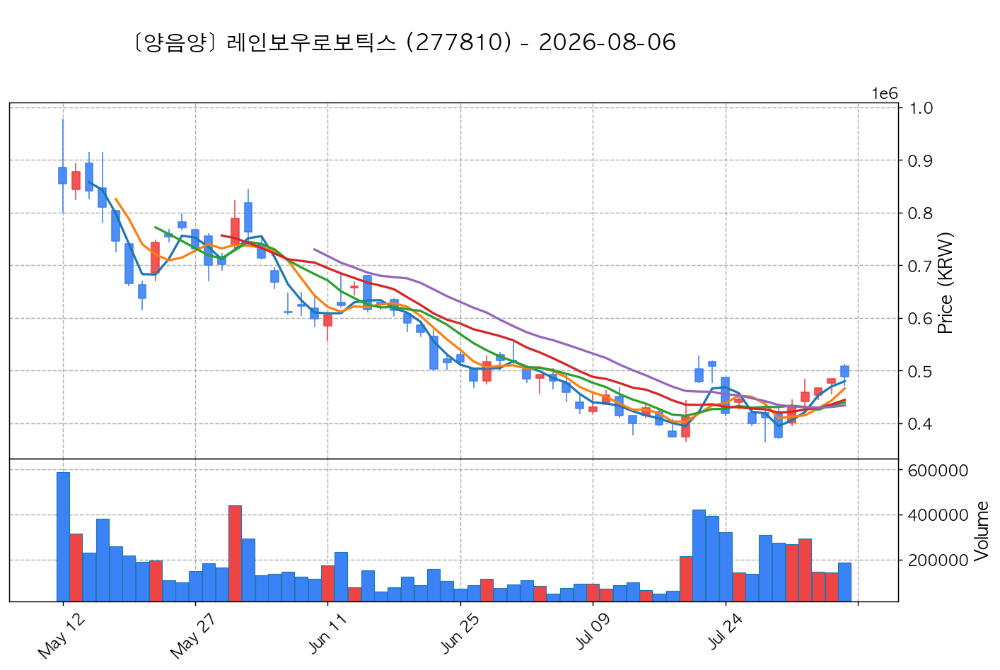
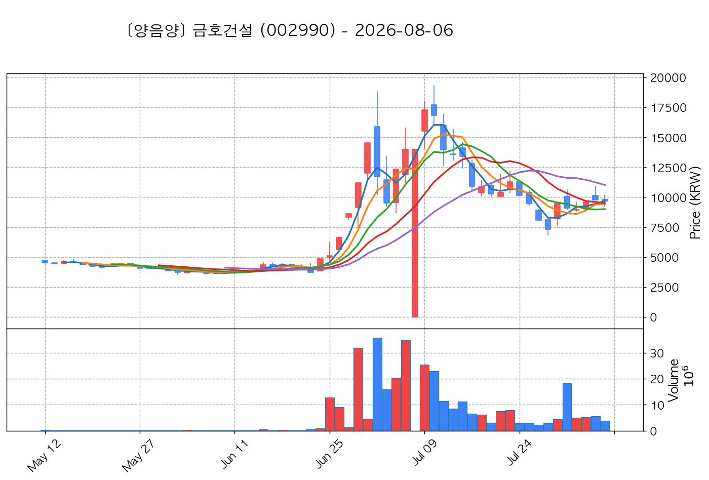

# 📈 [실전플랜 1] 2026-11-20 매매 후보 스크리닝 보고서

> 스크리닝 기준일: 2026-11-20 | [📊 익일 매매 성과 피드백 보고서 보기](./2026-11-20_피드백.html)

---

## 📊 1. 스크리닝 성과 요약

| 전략 | 주요 기법 | 종목수(TOP) |
| :--- | :--- | :---: |
| **전략 1** | 양음양 눌림목 & 사윗감 | 13개 (TOP 3개) |
| **전략 2** | 매집봉 & 이일홍 | 5개 (TOP 1개) |
| **전략 3** | 수급 & 핥 | 1개 (TOP 1개) |
| **합계** | **3대 핵심 전략 통합** | **19개 (TOP 5개)** |

---

## 🔵 3. 전략 1 — 양-음-양 눌림목 (3% × 3슬롯)

### 📋 전략 1 요약표 (상위 10개)

| 종목명 | 기준일종가 | 기준봉 | 지지선 | 비고 및 선정 상태 |
| :--- | ---: | :--- | :---: | :--- |
| **지니언스** (263860) | 36,950원 | +29.1% 장대양봉 | 3일선 | **★ TOP 1 선택** |
| **JYP Ent.** (035900) | 47,500원 | +23.1% 장대양봉 | 5일선 | **★ TOP 2 선택** |
| **레인보우로보틱스** (277810) | 409,000원 | +19.8% 장대양봉 | 3일선 | **★ TOP 3 선택** |
| **하이브** (352820) | 185,000원 | +16.1% 장대양봉 | 3일선 | 후보군 (1위) |
| **금호건설** (002990) | 9,340원 | +22.5% 장대양봉 | 13일선 | 후보군 (2위) (사윗감) |
| **AP위성** (211270) | 8,900원 | +15.2% 장대양봉 | 20일선 | 후보군 (3위) (사윗감) |
| **나무가** (190510) | 15,500원 | +28.9% 장대양봉 | 13일선 | 후보군 (4위) |
| **에스엠** (041510) | 99,100원 | 상한가 | 3일선 | 후보군 (5위) |
| **가온칩스** (399720) | 33,050원 | 상한가 | 13일선 | 후보군 (6위) |
| **지슨** (446840) | 6,310원 | 상한가 | 3일선 | 후보군 (7위) |

---

### 🔍 전략 1 상세 분석

#### 1) 지니언스 (263860) — ★ TOP 1 선택

- **기준 종가**: 36,950원 | **거래대금**: 631억
- **분석 사유**: 과거 2026-11-12 기준봉 후 현재 3일선 지지

#### 2) JYP Ent. (035900) — ★ TOP 2 선택

- **기준 종가**: 47,500원 | **거래대금**: 424억
- **분석 사유**: 과거 2026-11-18 기준봉 후 현재 5일선 지지

#### 3) 레인보우로보틱스 (277810) — ★ TOP 3 선택

- **기준 종가**: 409,000원 | **거래대금**: 436억
- **분석 사유**: 과거 2026-11-18 기준봉 후 현재 3일선 지지

#### 4) 하이브 (352820) — 후보군 (1위)

- **기준 종가**: 185,000원 | **거래대금**: 859억
- **분석 사유**: 과거 2026-11-18 기준봉 후 현재 3일선 지지

#### 5) 금호건설 (002990) — 후보군 (2위) (사윗감)

- **기준 종가**: 9,340원 | **거래대금**: 68억
- **분석 사유**: 🚨[매물대 저항] 과거 2026-11-13 기준봉 후 현재 13일선 지지
- **증권사 리포트**: 현대차(+163.2%)

#### 6) AP위성 (211270) — 후보군 (3위) (사윗감)

- **기준 종가**: 8,900원 | **거래대금**: 27억
- **분석 사유**: 🚨[매물대 저항] 🔥[20선 이탈 반등] 과거 2026-11-12 기준봉 후 현재 20일선 지지

#### 7) 나무가 (190510) — 후보군 (4위)

- **기준 종가**: 15,500원 | **거래대금**: 92억
- **분석 사유**: 🚨[매물대 저항] 🔥[20선 이탈 반등] 과거 2026-11-16 기준봉 후 현재 13일선 지지

#### 8) 에스엠 (041510) — 후보군 (5위)

- **기준 종가**: 99,100원 | **거래대금**: 559억
- **분석 사유**: 과거 2026-11-18 기준봉 후 현재 3일선 지지

#### 9) 가온칩스 (399720) — 후보군 (6위)

- **기준 종가**: 33,050원 | **거래대금**: 37억
- **분석 사유**: 🚨[매물대 저항] 🔥[20선 이탈 반등] 과거 2026-11-13 기준봉 후 현재 13일선 지지

#### 10) 지슨 (446840) — 후보군 (7위)

- **기준 종가**: 6,310원 | **거래대금**: 187억
- **분석 사유**: 🌪️ [C타입 갭상승털기] 기준봉 익일 갭상승 후 음봉 손바꿈 (기준봉 50% 사수)

## 🟡 4. 전략 2 — 일일봉 매집봉 (10% × 1슬롯)

### 📋 전략 2 요약표 (상위 5개)

| 종목명 | 기준일종가 | 기준봉 | 지지선 | 비고 및 선정 상태 |
| :--- | ---: | :--- | :---: | :--- |
| **글로벌텍스프리** (204620) | 6,220원 | ★ [1순위 키움정석] 40일 최고가 근접 + 60일선 상승 + 시가대비 +14.3% 속양봉 | 240일선 | **★ TOP 1 선택** |
| **삐아** (451250) | 7,810원 | ★ [1순위 키움정석] 40일 최고가 근접 + 60일선 상승 + 시가대비 +26.8% 속양봉 | 240일선 | 후보군 (1위) |
| **모두투어** (080160) | 10,180원 | 과거 2026-11-10 매집봉 ➔ 240일선 근접 지지 (+1.52%) | 240일선 | 후보군 (2위) |
| **에스피소프트** (443670) | 4,575원 | 과거 2026-10-29 매집봉 ➔ 240일선 근접 지지 (+0.16%) | 240일선 | 후보군 (3위) |
| **인바디** (041830) | 42,550원 | 과거 2026-11-05 매집봉 ➔ 240일선 근접 지지 (+0.87%) | 240일선 | 후보군 (4위) |

---

### 🔍 전략 2 상세 분석

#### 1) 글로벌텍스프리 (204620) — ★ TOP 1 선택

- **기준 종가**: 6,220원 | **거래대금**: 293억
- **분석 사유**: ★ [1순위 키움정석] 40일 최고가 근접 + 60일선 상승 + 시가대비 +14.3% 속양봉

#### 2) 삐아 (451250) — 후보군 (1위)

- **기준 종가**: 7,810원 | **거래대금**: 58억
- **분석 사유**: ★ [1순위 키움정석] 40일 최고가 근접 + 60일선 상승 + 시가대비 +26.8% 속양봉

#### 3) 모두투어 (080160) — 후보군 (2위)

- **기준 종가**: 10,180원 | **거래대금**: 97억
- **분석 사유**: 과거 2026-11-10 매집봉 ➔ 240일선 근접 지지 (+1.52%)

#### 4) 에스피소프트 (443670) — 후보군 (3위)

- **기준 종가**: 4,575원 | **거래대금**: 27억
- **분석 사유**: 과거 2026-10-29 매집봉 ➔ 240일선 근접 지지 (+0.16%)

#### 5) 인바디 (041830) — 후보군 (4위)

- **기준 종가**: 42,550원 | **거래대금**: 20억
- **분석 사유**: 과거 2026-11-05 매집봉 ➔ 240일선 근접 지지 (+0.87%)

## 🟢 5. 전략 3 — 수급 낙폭과대 바닥형 (10% × 2슬롯)

### 📋 전략 3 요약표 (상위 1개)

| 종목명 | 기준일종가 | 기준봉 | 지지선 | 비고 및 선정 상태 |
| :--- | ---: | :--- | :---: | :--- |
| **카카오** (035720) | 31,000원 | 52주 고점 대비 (48.1%) ➔ 20일 메이저 수급 100억+ 유입 ➔ 없음 지지 안착 | 수급선 | **★ TOP 1 선택** |

---

### 🔍 전략 3 상세 분석

#### 1) 카카오 (035720) — ★ TOP 1 선택

- **기준 종가**: 31,000원 | **거래대금**: 388억
- **분석 사유**: 52주 고점 대비 (48.1%) ➔ 20일 메이저 수급 100억+ 유입 ➔ 없음 지지 안착

