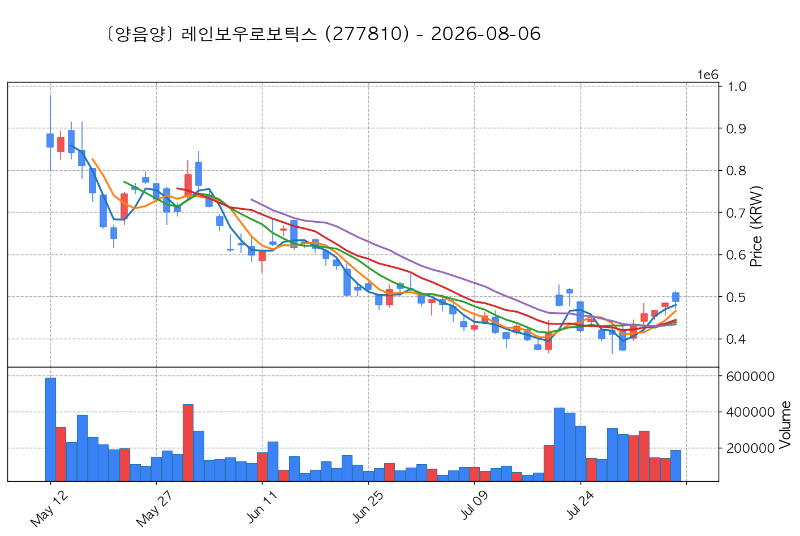
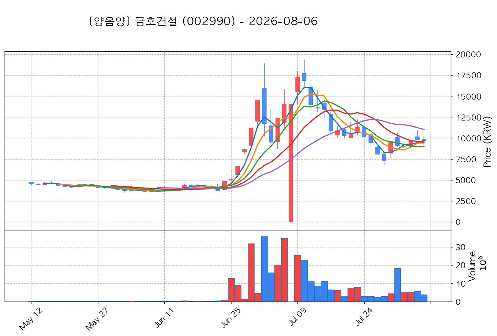
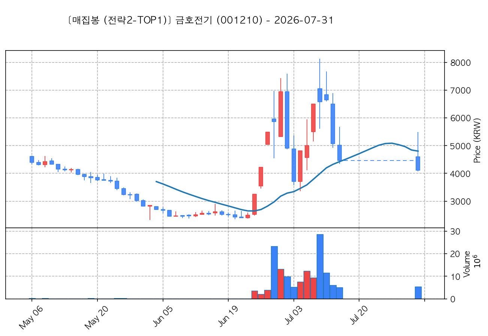

# 📈 [실전플랜 1] 2026-11-23 매매 후보 스크리닝 보고서

> 스크리닝 기준일: 2026-11-23 | [📊 익일 매매 성과 피드백 보고서 보기](./2026-11-23_피드백.html)

---

## 📊 1. 스크리닝 성과 요약

| 전략 | 주요 기법 | 종목수(TOP) |
| :--- | :--- | :---: |
| **전략 1** | 양음양 눌림목 & 사윗감 | 9개 (TOP 3개) |
| **전략 2** | 매집봉 & 이일홍 | 3개 (TOP 1개) |
| **전략 3** | 수급 & 핥 | 1개 (TOP 1개) |
| **합계** | **3대 핵심 전략 통합** | **13개 (TOP 5개)** |

---

## 🔵 3. 전략 1 — 양-음-양 눌림목 (3% × 3슬롯)

### 📋 전략 1 요약표 (상위 9개)

| 종목명 | 기준일종가 | 기준봉 | 지지선 | 비고 및 선정 상태 |
| :--- | ---: | :--- | :---: | :--- |
| **JYP Ent.** (035900) | 46,100원 | +23.1% 장대양봉 | 3일선 | **★ TOP 1 선택** |
| **레인보우로보틱스** (277810) | 408,000원 | +19.8% 장대양봉 | 3일선 | **★ TOP 2 선택** |
| **하이브** (352820) | 173,100원 | +16.1% 장대양봉 | 5일선 | **★ TOP 3 선택** |
| **금호건설** (002990) | 9,510원 | +22.5% 장대양봉 | 13일선 | 후보군 (1위) (사윗감) |
| **금호전기** (001210) | 6,370원 | +22.8% 장대양봉 | 3일선 | 후보군 (2위) |
| **마녀공장** (439090) | 16,000원 | +17.8% 장대양봉 | 3일선 | 후보군 (3위) |
| **나무가** (190510) | 15,350원 | +28.9% 장대양봉 | 3일선 | 후보군 (4위) |
| **에스엠** (041510) | 94,300원 | 상한가 | 3일선 | 후보군 (5위) |
| **가온칩스** (399720) | 32,000원 | 상한가 | 13일선 | 후보군 (6위) |

---

### 🔍 전략 1 상세 분석

#### 1) JYP Ent. (035900) — ★ TOP 1 선택

- **기준 종가**: 46,100원 | **거래대금**: 229억
- **분석 사유**: 과거 2026-11-18 기준봉 후 현재 3일선 지지

#### 2) 레인보우로보틱스 (277810) — ★ TOP 2 선택

- **기준 종가**: 408,000원 | **거래대금**: 757억
- **분석 사유**: 과거 2026-11-18 기준봉 후 현재 3일선 지지

#### 3) 하이브 (352820) — ★ TOP 3 선택

- **기준 종가**: 173,100원 | **거래대금**: 459억
- **분석 사유**: 과거 2026-11-18 기준봉 후 현재 5일선 지지

#### 4) 금호건설 (002990) — 후보군 (1위) (사윗감)

- **기준 종가**: 9,510원 | **거래대금**: 212억
- **분석 사유**: 🚨[매물대 저항] 과거 2026-11-13 기준봉 후 현재 13일선 지지

#### 5) 금호전기 (001210) — 후보군 (2위)

- **기준 종가**: 6,370원 | **거래대금**: 38억
- **분석 사유**: 🚨[매물대 저항] 🔥[20선 이탈 반등] 과거 2026-11-13 기준봉 후 현재 3일선 지지

#### 6) 마녀공장 (439090) — 후보군 (3위)

- **기준 종가**: 16,000원 | **거래대금**: 176억
- **분석 사유**: 🚨[매물대 저항] 과거 2026-11-20 기준봉 후 현재 3일선 지지

#### 7) 나무가 (190510) — 후보군 (4위)

- **기준 종가**: 15,350원 | **거래대금**: 33억
- **분석 사유**: 🚨[매물대 저항] 🔥[20선 이탈 반등] 과거 2026-11-16 기준봉 후 현재 3일선 지지

#### 8) 에스엠 (041510) — 후보군 (5위)

- **기준 종가**: 94,300원 | **거래대금**: 330억
- **분석 사유**: 과거 2026-11-18 기준봉 후 현재 3일선 지지

#### 9) 가온칩스 (399720) — 후보군 (6위)

- **기준 종가**: 32,000원 | **거래대금**: 43억
- **분석 사유**: 🚨[매물대 저항] 🔥[20선 이탈 반등] 과거 2026-11-13 기준봉 후 현재 13일선 지지

## 🟡 4. 전략 2 — 일일봉 매집봉 (10% × 1슬롯)

### 📋 전략 2 요약표 (상위 3개)

| 종목명 | 기준일종가 | 기준봉 | 지지선 | 비고 및 선정 상태 |
| :--- | ---: | :--- | :---: | :--- |
| **광전자** (017900) | 6,420원 | 과거 2026-10-29 매집봉 ➔ 240일선 근접 지지 (+0.57%) | 240일선 | **★ TOP 1 선택** |
| **한싹** (430690) | 3,710원 | 과거 2026-11-04 매집봉 ➔ 240일선 근접 지지 (+2.16%) | 240일선 | 후보군 (1위) |
| **모두투어** (080160) | 10,060원 | 과거 2026-11-10 매집봉 ➔ 240일선 근접 지지 (+0.34%) | 240일선 | 후보군 (2위) |

---

### 🔍 전략 2 상세 분석

#### 1) 광전자 (017900) — ★ TOP 1 선택

- **기준 종가**: 6,420원 | **거래대금**: 37억
- **분석 사유**: 과거 2026-10-29 매집봉 ➔ 240일선 근접 지지 (+0.57%)

#### 2) 한싹 (430690) — 후보군 (1위)

- **기준 종가**: 3,710원 | **거래대금**: 23억
- **분석 사유**: 과거 2026-11-04 매집봉 ➔ 240일선 근접 지지 (+2.16%)

#### 3) 모두투어 (080160) — 후보군 (2위)

- **기준 종가**: 10,060원 | **거래대금**: 22억
- **분석 사유**: 과거 2026-11-10 매집봉 ➔ 240일선 근접 지지 (+0.34%)

## 🟢 5. 전략 3 — 수급 낙폭과대 바닥형 (10% × 2슬롯)

### 📋 전략 3 요약표 (상위 1개)

| 종목명 | 기준일종가 | 기준봉 | 지지선 | 비고 및 선정 상태 |
| :--- | ---: | :--- | :---: | :--- |
| **카카오** (035720) | 29,000원 | 52주 고점 대비 (45.0%) ➔ 20일 메이저 수급 100억+ 유입 ➔ 없음 지지 안착 | 수급선 | **★ TOP 1 선택** |

---

### 🔍 전략 3 상세 분석

#### 1) 카카오 (035720) — ★ TOP 1 선택

- **기준 종가**: 29,000원 | **거래대금**: 491억
- **분석 사유**: 52주 고점 대비 (45.0%) ➔ 20일 메이저 수급 100억+ 유입 ➔ 없음 지지 안착

