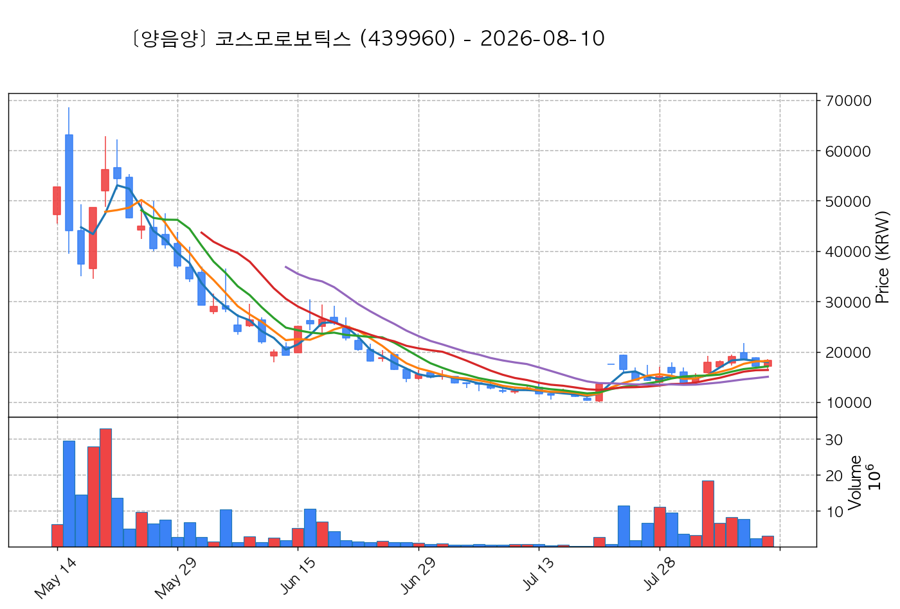
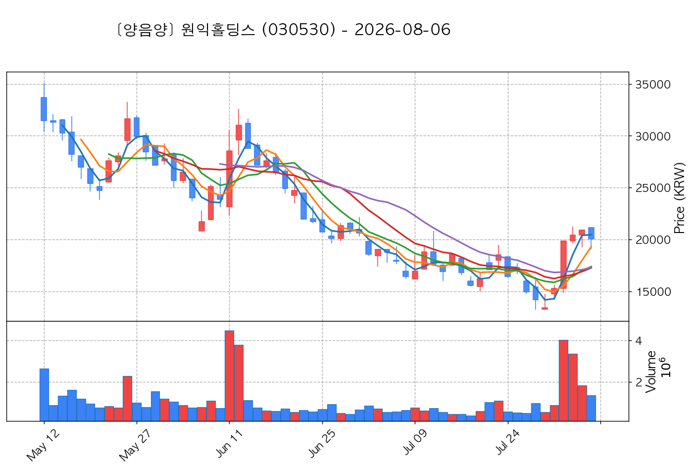

# 📈 [실전플랜 1] 2026-11-26 매매 후보 스크리닝 보고서

> 스크리닝 기준일: 2026-11-26 | [📊 익일 매매 성과 피드백 보고서 보기](./2026-11-26_피드백.html)

---

## 📊 1. 스크리닝 성과 요약

| 전략 | 주요 기법 | 종목수(TOP) |
| :--- | :--- | :---: |
| **전략 1** | 양음양 눌림목 & 사윗감 | 7개 (TOP 3개) |
| **전략 2** | 매집봉 & 이일홍 | 6개 (TOP 1개) |
| **전략 3** | 수급 & 핥 | 1개 (TOP 1개) |
| **합계** | **3대 핵심 전략 통합** | **14개 (TOP 5개)** |

---

## 🔵 3. 전략 1 — 양-음-양 눌림목 (3% × 3슬롯)

### 📋 전략 1 요약표 (상위 7개)

| 종목명 | 기준일종가 | 기준봉 | 지지선 | 비고 및 선정 상태 |
| :--- | ---: | :--- | :---: | :--- |
| **현대오토에버** (307950) | 350,500원 | +23.0% 장대양봉 | 3일선 | **★ TOP 1 선택** (사윗감) |
| **마녀공장** (439090) | 17,010원 | +17.8% 장대양봉 | 3일선 | **★ TOP 2 선택** |
| **코스모로보틱스** (439960) | 4,400원 | 상한가 | 3일선 | **★ TOP 3 선택** (사윗감) |
| **스튜디오드래곤** (253450) | 34,150원 | 상한가 | 3일선 | 후보군 (1위) |
| **삐아** (451250) | 7,920원 | 상한가 | 3일선 | 후보군 (2위) (사윗감) |
| **액트로** (290740) | 9,250원 | 상한가 | 3일선 | 후보군 (3위) (사윗감) |
| **휴림에이텍** (078590) | 3,345원 | 상한가 | 3일선 | 후보군 (4위) |

---

### 🔍 전략 1 상세 분석

#### 1) 현대오토에버 (307950) — ★ TOP 1 선택 (사윗감)

- **기준 종가**: 350,500원 | **거래대금**: 405억
- **분석 사유**: 과거 2026-11-24 기준봉 후 현재 3일선 지지

#### 2) 마녀공장 (439090) — ★ TOP 2 선택

- **기준 종가**: 17,010원 | **거래대금**: 99억
- **분석 사유**: 과거 2026-11-20 기준봉 후 현재 3일선 지지

#### 3) 코스모로보틱스 (439960) — ★ TOP 3 선택 (사윗감)

- **기준 종가**: 4,400원 | **거래대금**: 89억
- **분석 사유**: 🚨[매물대 저항] 과거 2026-11-23 기준봉 후 현재 3일선 지지

#### 4) 스튜디오드래곤 (253450) — 후보군 (1위)

- **기준 종가**: 34,150원 | **거래대금**: 133억
- **분석 사유**: 과거 2026-11-18 기준봉 후 현재 3일선 지지
- **증권사 리포트**: 대신(+28.6%)

#### 5) 삐아 (451250) — 후보군 (2위) (사윗감)

- **기준 종가**: 7,920원 | **거래대금**: 28억
- **분석 사유**: 🚨[매물대 저항] 과거 2026-11-20 기준봉 후 현재 3일선 지지

#### 6) 액트로 (290740) — 후보군 (3위) (사윗감)

- **기준 종가**: 9,250원 | **거래대금**: 37억
- **분석 사유**: 과거 2026-11-24 기준봉 후 현재 3일선 지지

#### 7) 휴림에이텍 (078590) — 후보군 (4위)

- **기준 종가**: 3,345원 | **거래대금**: 143억
- **분석 사유**: 과거 2026-11-24 기준봉 후 현재 3일선 지지

## 🟡 4. 전략 2 — 일일봉 매집봉 (10% × 1슬롯)

### 📋 전략 2 요약표 (상위 6개)

| 종목명 | 기준일종가 | 기준봉 | 지지선 | 비고 및 선정 상태 |
| :--- | ---: | :--- | :---: | :--- |
| **원익홀딩스** (030530) | 28,100원 | 과거 2026-10-28 매집봉 ➔ 240일선 근접 지지 (-1.96%) | 240일선 | **★ TOP 1 선택** |
| **나무가** (190510) | 17,500원 | 과거 2026-10-28 매집봉 ➔ 240일선 근접 지지 (+1.18%) | 240일선 | 후보군 (1위) |
| **깨끗한나라** (004540) | 1,652원 | 과거 2026-11-04 매집봉 ➔ 240일선 근접 지지 (+2.19%) | 240일선 | 후보군 (2위) |
| **삼진제약** (005500) | 19,320원 | 과거 2026-11-18 매집봉 ➔ 240일선 근접 지지 (+1.46%) | 240일선 | 후보군 (3위) |
| **광전자** (017900) | 6,270원 | 과거 2026-10-29 매집봉 ➔ 240일선 근접 지지 (-2.64%) | 240일선 | 후보군 (4위) |
| **엔키AX** (134580) | 1,906원 | 과거 2026-11-16 매집봉 ➔ 240일선 근접 지지 (+2.09%) | 240일선 | 후보군 (5위) |

---

### 🔍 전략 2 상세 분석

#### 1) 원익홀딩스 (030530) — ★ TOP 1 선택

- **기준 종가**: 28,100원 | **거래대금**: 748억
- **분석 사유**: 과거 2026-10-28 매집봉 ➔ 240일선 근접 지지 (-1.96%)

#### 2) 나무가 (190510) — 후보군 (1위)

- **기준 종가**: 17,500원 | **거래대금**: 456억
- **분석 사유**: 과거 2026-10-28 매집봉 ➔ 240일선 근접 지지 (+1.18%)

#### 3) 깨끗한나라 (004540) — 후보군 (2위)

- **기준 종가**: 1,652원 | **거래대금**: 237억
- **분석 사유**: 과거 2026-11-04 매집봉 ➔ 240일선 근접 지지 (+2.19%)

#### 4) 삼진제약 (005500) — 후보군 (3위)

- **기준 종가**: 19,320원 | **거래대금**: 64억
- **분석 사유**: 과거 2026-11-18 매집봉 ➔ 240일선 근접 지지 (+1.46%)

#### 5) 광전자 (017900) — 후보군 (4위)

- **기준 종가**: 6,270원 | **거래대금**: 25억
- **분석 사유**: 과거 2026-10-29 매집봉 ➔ 240일선 근접 지지 (-2.64%)

#### 6) 엔키AX (134580) — 후보군 (5위)

- **기준 종가**: 1,906원 | **거래대금**: 17억
- **분석 사유**: 과거 2026-11-16 매집봉 ➔ 240일선 근접 지지 (+2.09%)

## 🟢 5. 전략 3 — 수급 낙폭과대 바닥형 (10% × 2슬롯)

### 📋 전략 3 요약표 (상위 1개)

| 종목명 | 기준일종가 | 기준봉 | 지지선 | 비고 및 선정 상태 |
| :--- | ---: | :--- | :---: | :--- |
| **카카오** (035720) | 30,300원 | 52주 고점 대비 (47.0%) ➔ 20일 메이저 수급 100억+ 유입 ➔ 없음 지지 안착 | 수급선 | **★ TOP 1 선택** |

---

### 🔍 전략 3 상세 분석

#### 1) 카카오 (035720) — ★ TOP 1 선택

- **기준 종가**: 30,300원 | **거래대금**: 185억
- **분석 사유**: 52주 고점 대비 (47.0%) ➔ 20일 메이저 수급 100억+ 유입 ➔ 없음 지지 안착

